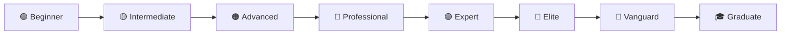

## 🧭 Table of Contents

- [🟢 After Beginner Level](#despues-del-nivel-principiante)
- [🟡 After Intermediate Level](#despues-del-nivel-intermedio)
- [🟠 After Advanced Level](#despues-del-nivel-avanzado)
- [🔴 After Professional Level](#despues-del-nivel-profesional)
- [🟣 After Expert Level](#despues-del-nivel-experto)
- [🔵 After Elite Level](#despues-del-nivel-elite)
- [🚀 After Vanguard Level](#despues-del-nivel-vanguardia)

---

## 🟢 After Beginner Level { #despues-del-nivel-principiante }

You've finished chapters 01–06. You already know HTML, CSS, basic JavaScript, responsive design, and forms. What now?

### 📚 Books

| Book | Author | Why Read It |
| :--- | :--- | :--- |
| *HTML and CSS: Design and Build Websites* | Jon Duckett | The most visual and approachable book to cement the fundamentals. |
| *Eloquent JavaScript* | Marijn Haverbeke | To go deeper into JavaScript. [Free online](https://eloquentjavascript.net/). |
| *CSS: The Definitive Guide* | Eric A. Meyer | The CSS bible, to look things up whenever you have questions. |

### 🎥 Channels

- [MiduDev](https://www.youtube.com/@midudev) — JavaScript, React, and industry news.
- [Fazt](https://www.youtube.com/@FaztTech) — Full-stack, step-by-step tutorials.
- [HolaMundo](https://www.youtube.com/@HolaMundo) — General programming.

### 📖 Documentation

- [MDN Web Docs](https://developer.mozilla.org/) — the definitive reference.
- [CSS Tricks](https://css-tricks.com/) — CSS tricks and articles.

### 🛠 Practice Projects

- [ ] A **personal page** about your hobbies.
- [ ] A **landing page** for a fictional business.
- [ ] A **contact form** with validation.

### 🎯 Next Step

Once you feel comfortable with HTML, CSS, and basic JavaScript, move on to **Intermediate Level** (chapters 07–10), where you'll learn Git, APIs, deployment, and your first portfolio.

---

## 🟡 After Intermediate Level { #despues-del-nivel-intermedio }

You've finished chapters 07–10. You already know Git, consuming APIs, deploying to production, and you have a portfolio. What now?

### 📚 Books

| Book | Author | Why Read It |
| :--- | :--- | :--- |
| *You Don't Know JS Yet* (series) | Kyle Simpson | To truly understand JavaScript. [Free on GitHub](https://github.com/getify/You-Dont-Know-JS). |
| *The Pragmatic Programmer* | Hunt & Thomas | The book I've gifted the most. Teaches how to think like a programmer. |
| *Refactoring* | Martin Fowler | How to improve existing code without breaking it. |

### 🎥 Channels

- [Fireship](https://www.youtube.com/@Fireship) — Everything, in 100 seconds.
- [Kevin Powell](https://www.youtube.com/@KevinPowell) — Deep-dive CSS.
- [The Net Ninja](https://www.youtube.com/@NetNinja) — Full series.

### 📖 Documentation

- [Git Book](https://git-scm.com/book/en/v2) — the official Git book, free.
- [JavaScript.info](https://javascript.info/) — the best modern JavaScript tutorial.

### 🛠 Practice Projects

- [ ] An **app consuming a public API** (weather, movies, jokes…).
- [ ] A **clone of a well-known site** (visual layer only).
- [ ] A **to-do list** with localStorage.

### 🎯 Next Step

Once you master Git and APIs, move on to **Advanced Level** (chapters 11–18), where you'll learn modern CSS, TypeScript, testing, and frontend architecture.

---

## 🟠 After Advanced Level { #despues-del-nivel-avanzado }

You've finished chapters 11–18. You already know modern CSS, asynchronous JavaScript, TypeScript, testing, and architecture. What now?

### 📚 Books

| Book | Author | Why Read It |
| :--- | :--- | :--- |
| *Clean Code* | Robert C. Martin | Clean code best practices. |
| *Refactoring UI* | Adam Wathan & Steve Schoger | How to make your interfaces look professional. |
| *Design Systems* | Alla Kholmatova | How to build scalable design systems. |

### 🎥 Channels

- [Theo - t3.gg](https://www.youtube.com/@t3dotgg) — React, TypeScript, opinions.
- [Web Dev Simplified](https://www.youtube.com/@WebDevSimplified) — JavaScript, React.
- [Josh Comeau](https://www.joshwcomeau.com/) — CSS, React, animations.

### 📖 Documentation

- [TypeScript Handbook](https://www.typescriptlang.org/docs/handbook/) — the official TypeScript guide.
- [Testing Library](https://testing-library.com/) — component testing.
- [Vitest](https://vitest.dev/) — ultra-fast testing.

### 🛠 Practice Projects

- [ ] An **app with TypeScript + Vite + Vitest**.
- [ ] A **design system** with reusable components.
- [ ] A **static blog** with Markdown and search.

### 🎯 Next Step

Once you master TypeScript and testing, move on to **Professional Level** (chapters 19–20), where you'll learn Full-stack with Node.js and DevOps for frontend.

---

## 🔴 After Professional Level { #despues-del-nivel-profesional }

You've finished chapters 19–20. You already know Node.js, Express, databases, and basic DevOps. What now?

### 📚 Books

| Book | Author | Why Read It |
| :--- | :--- | :--- |
| *Designing Data-Intensive Applications* | Martin Kleppmann | The distributed systems bible. |
| *The Web Application Hacker's Handbook* | Stuttard & Pinto | In-depth web security. |
| *Site Reliability Engineering* | Google | How to run systems in production. |

### 🎥 Channels

- [Hussein Nasser](https://www.youtube.com/@hnasr) — Backend, networking, databases.
- [Traversy Media](https://www.youtube.com/@TraversyMedia) — Full-stack, tutorials.

### 📖 Documentation

- [Node.js Docs](https://nodejs.org/docs/latest/api/) — official documentation.
- [Express Docs](https://expressjs.com/) — the Node.js web framework.
- [PostgreSQL Docs](https://www.postgresql.org/docs/) — the relational database.

### 🛠 Practice Projects

- [ ] A **REST API with JWT authentication** and PostgreSQL.
- [ ] A **Twitter clone** (backend).
- [ ] A **deployment pipeline** with Docker and CI/CD.

### 🎯 Next Step

Once you master Node.js and DevOps, move on to **Expert Level** (chapters 21–25), where you'll learn Web Components, PWA, WebSockets, animations, and design systems.

---

## 🟣 After Expert Level { #despues-del-nivel-experto }

You've finished chapters 21–25. You already know Web Components, PWA, WebSockets, advanced animations, and design systems. What now?

### 📚 Books

| Book | Author | Why Read It |
| :--- | :--- | :--- |
| *Web Components in Action* | Ben Farrell | The definitive guide to Web Components. |
| *Learning PWA* | Tal Ater | How to build Progressive Web Apps. |

### 🎥 Channels

- [Google Chrome Developers](https://www.youtube.com/@ChromeDevs) — web.dev, PWA, performance.
- [Kevin Powell](https://www.youtube.com/@KevinPowell) — Advanced CSS.

### 📖 Documentation

- [web.dev](https://web.dev/) — performance, accessibility, and PWA guides.
- [Web Components](https://developer.mozilla.org/en-US/docs/Web/Web_Components) — on MDN.
- [Service Workers](https://developer.mozilla.org/en-US/docs/Web/API/Service_Worker_API) — on MDN.

### 🛠 Practice Projects

- [ ] An **installable PWA** with offline support.
- [ ] A **real-time chat** with WebSockets.
- [ ] A **component library** built with Web Components.

### 🎯 Next Step

Once you master PWAs and WebSockets, move on to **Elite Level** (chapters 26–30), where you'll learn security, WebAssembly, AI, WebXR, and Web3.

---

## 🔵 After Elite Level { #despues-del-nivel-elite }

You've finished chapters 26–30. You already know web security, WebAssembly, frontend AI, WebXR, and Web3. What now?

### 📚 Books

| Book | Author | Why Read It |
| :--- | :--- | :--- |
| *The Web Application Hacker's Handbook* | Stuttard & Pinto | In-depth web security. |
| *WebAssembly: The Definitive Guide* | Brian Sletten | The definitive guide to WebAssembly. |

### 🎥 Channels

- [LiveOverflow](https://www.youtube.com/@LiveOverflow) — security, CTFs.
- [TensorFlow](https://www.youtube.com/@tensorflow) — AI in the browser.

### 📖 Documentation

- [OWASP Top 10](https://owasp.org/www-project-top-ten/) — the 10 most common vulnerabilities.
- [WebAssembly](https://webassembly.org/) — the official standard.
- [WebXR](https://immersiveweb.dev/) — virtual and augmented reality on the web.

### 🛠 Practice Projects

- [ ] A **security audit** of one of your own apps.
- [ ] A **WebAssembly game** (with Rust or C++).
- [ ] A **WebXR experience** (AR or VR).

### 🎯 Next Step

Once you master security and WebAssembly, move on to **Vanguard Level** (chapters 31–38), where you'll learn E2E testing, Server Components, Edge Computing, Docker, GraphQL, Micro-frontends, generative AI, and advanced security.

---

## 🚀 After Vanguard Level { #despues-del-nivel-vanguardia }

You've finished chapters 31–38. **You've completed the book.** What now?

### 📚 Books

| Book | Author | Why Read It |
| :--- | :--- | :--- |
| *Designing Data-Intensive Applications* | Martin Kleppmann | If you want to go deeper into systems. |
| *Staff Engineer* | Will Larson | How to grow as a developer without becoming a manager. |
| *The Staff Engineer's Path* | Tanya Reilly | The next step in your career. |

### 🎥 Channels

- [Vercel](https://www.youtube.com/@VercelHQ) — edge, RSC, Next.js.
- [Theo - t3.gg](https://www.youtube.com/@t3dotgg) — React, TypeScript, opinions.

### 📖 Documentation

- [Cloudflare Workers](https://developers.cloudflare.com/workers/) — Edge Computing.
- [GraphQL](https://graphql.org/) — the API query standard.
- [Playwright](https://playwright.dev/) — E2E testing.

### 🛠 Practice Projects

- [ ] A **micro-frontend** deployed at the edge.
- [ ] A **GraphQL API** with authentication.
- [ ] A **generative AI system** integrated into an app.

### 🎓 What Now?

You've completed the book. Now it's time to:

1. **Generate your [certificate](../certificado.md)** and share it.
2. **Appear in the [Hall of Fame](../hall-of-fame.md)**.
3. **Contribute to the project** ([Contribute](../contribuir.md)).
4. **Teach others** what you've learned.
5. **Keep learning**: the web never stops evolving.

---

## 📊 Visual Summary

