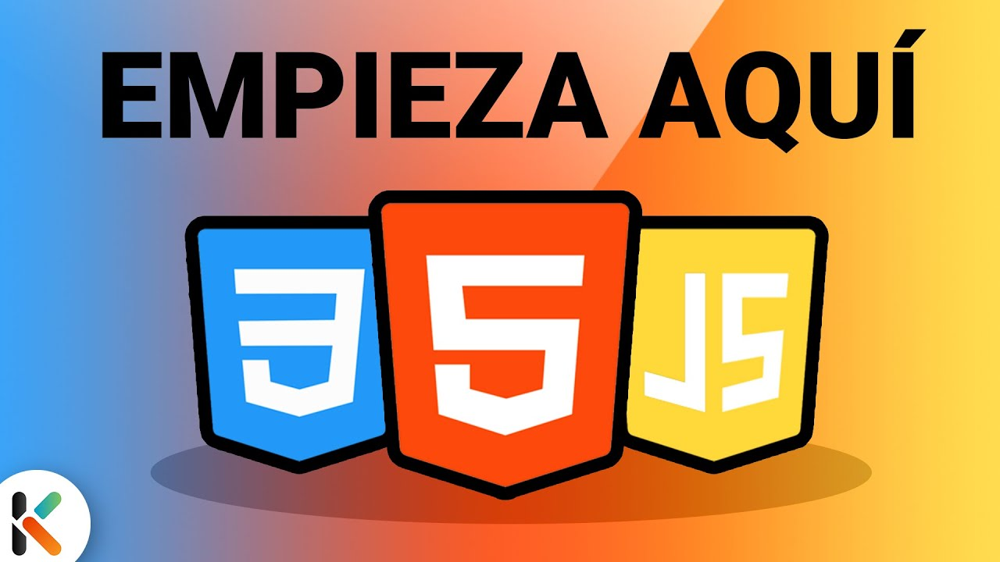

# 👤 About the Author

!!! quote "Hi, I'm Urukais"
    My name is **Manuel Casimiro Carrasco**, though online you'll know me as **Urukais**. I'm a web developer, technical educator, and creator of the *Web Developer Book*.

---

## 🖼 A bit about me

I got into programming out of **curiosity**, like almost everyone else. One day I wanted to build a website for a personal project, started searching for tutorials, and realized most of them were in English, paid, or made unrealistic promises ("learn to code in 24 hours").

Over the years, the notes I was jotting down turned into a giant text file. And that text file became **this book**.

Today I balance my work as a developer with writing and maintaining the project. I try to explain things the way I wish they had been explained to me: **no fluff, no empty promises, and with code examples that actually work**.

---

## 🛤 My journey

### Early days (2015–2017)

My first brush with programming was through **HTML and CSS**, building a site for a class project. I still remember the feeling of writing a tag and seeing the result in the browser. It was addictive.

Then came **JavaScript**, which at first felt strange and full of traps. It took me months to grasp concepts like `this`, the event loop, and closures. Once they clicked, everything else started making sense.

### The framework phase (2018–2020)

Like most people, I went through the "learn every framework" phase. I tried React, Vue, Angular, Svelte, Ember… And I learned an important lesson:

> **Frameworks come and go. Fundamentals stay.**

Ever since, my approach has been to master **JavaScript** properly before picking a specific tool. That philosophy runs through this book.

### Sharing & teaching (2021–present)

I started writing posts on a personal blog, then on Substack, and eventually took the plunge into this book. The idea was simple: **create the resource I wish I had found when starting out**, open and free.

The project grew beyond what I expected. Today readers from all over follow along, and that is by far the most rewarding part of the whole journey.

---

## 🛠 My favorite stack

These are the tools I work with day to day. They aren't the only ones or the best fit for every scenario, but they match how I like to build.

=== "Frontend"

    - **Semantic HTML5** — the foundation of everything
    - **Modern CSS** — Flexbox, Grid, custom properties, container queries
    - **JavaScript (ES2024)** — framework-free for small projects
    - **TypeScript** — when the project grows
    - **Astro** — for fast static sites
    - **Svelte** — when I want reactivity without overhead

=== "Backend"

    - **Node.js** — my primary runtime
    - **Express** — for straightforward APIs
    - **Fastify** — when performance matters
    - **SQLite** — for small projects
    - **PostgreSQL** — for serious applications

=== "Tools"

    - **VS Code** — my main editor
    - **Zed** — when I want something faster
    - **Vite** — default bundler
    - **Git + GitHub** — version control
    - **Docker** — when I need reproducibility
    - **Fish shell** — my everyday terminal

=== "Design"

    - **Figma** — for wireframes and designs
    - **Excalidraw** — for quick diagrams
    - **Mermaid** — for diagrams in Markdown
    - **Inter** — my favorite typeface
    - **JetBrains Mono** — for code

---

## 📚 What I'm reading

*(Updated periodically)*

| Book | Author | Status |
| :--- | :--- | :--- |
| *Designing Data-Intensive Applications* | Martin Kleppmann | 📖 Reading |
| *Refactoring UI* | Adam Wathan & Steve Schoger | ✅ Finished |
| *The Pragmatic Programmer* | Hunt & Thomas | 📖 Rereading |
| *You Don't Know JS Yet* | Kyle Simpson | ✅ Finished |
| *Eloquent JavaScript* | Marijn Haverbeke | ✅ Finished |

!!! tip "Recommendation"
    If I could recommend only one programming book, it would be ***The Pragmatic Programmer***. It doesn't teach a specific language—it teaches how to **think like a programmer**. It is the book I've gifted the most times.

---

## 🎯 Projects I've worked on

### 🌟 Web Developer Book *(2026–present)*

The project right in front of you. A free, open-source book teaching web development from scratch.

- **Stack**: MkDocs, Material for MkDocs, Python, GitHub Pages
- **Role**: author, developer, designer
- **Status**: active, constantly evolving

### 🎮 El Niño *(2024–2025)*

A small experimental web game built with Canvas and the Web Audio API.

- **Stack**: HTML5 Canvas, vanilla JavaScript, Web Audio
- **Role**: developer
- **Status**: finished (available on [my portfolio](https://silly-boba-dc057e.netlify.app/))

### 📝 Personal blog *(2021–present)*

Articles on web development, accessibility, and best practices.

- **Stack**: Astro, Markdown, Netlify
- **Role**: author and editor
- **Status**: active

- **Status**: finished (available on [my portfolio](https://soloist.ai/urukaisklick))

---

## 🎤 Talks and workshops

I have given talks and workshops on web development for:

- **Local developer communities**
- **JavaScript and frontend meetups**
- **Online workshops** for beginners
- **One-on-one mentoring**

If you'd like me to give a talk or workshop, email me at [urukaisk@gmail.com](mailto:contacto@urukais.com) with the details.

---

## 🧠 My teaching philosophy

After years of teaching, I've arrived at these takeaways:

1. **Learning by doing > passive reading.** Nobody learns to code just by reading. You have to type it out, make mistakes, and try again.

2. **Fundamentals are the only thing that doesn't expire.** Frameworks change every year, while HTML, CSS, and JavaScript have remained core for decades.

3. **Accessibility isn't an extra.** It's part of the job from the very first `
`.

4. **English isn't optional.** You don't need to speak it fluently, but you do need to read it. The best documentation is in English.

5. **Consistency beats intensity.** 30 minutes a day for a year beats 12 hours on a single weekend.

---

## 📊 Fun facts

- 💻 I've been coding since **2015**, and started teaching in **2025**.
- ☕ I drink **0–2 coffees** a day (trying to cut back).
- 🎧 I code with **Heavy Metal** or **Classical** music in the background. There's a music section in this book with my favorite playlists.
- 🌙 I do my best work **at night**, when there are no notifications.
- 📚 I prefer reading **on paper** when possible—technical books, digitally.
- 🎮 I love **creative coding**: visualizations, generative art, experimental games.

---

## 📬 Contact

| Channel | Link |
| :--- | :--- |
| **Email** | [urukaisk@gmail.com](mailto:urukaisk@gmail.com) |
| **GitHub** | [@urukaisk-maker](https://github.com/urukaisk-maker) |
| **Twitter / X** | [@urukaisk](https://twitter.com/urukaisk) |
| **LinkedIn** | [Manuel Casimiro Carrasco](https://www.linkedin.com/in/urukais/) |
| **Substack** | [urukaisklick.substack.com](https://urukaisklick.substack.com) |
| **Portfolio** | [silly-boba-dc057e.netlify.app](https://silly-boba-dc057e.netlify.app/) |

More details on the [Contact](contacto.md) page.

---

## 💬 One last thing

If you made it this far, we likely share something important: **the drive to learn**. No matter where you're starting from or how much you know right now, all that matters is that you keep going.

If this book helps you, it has already been worth it. And if one day you write your own, let me know—I'd love to read it.

> *"The best way to learn is to teach."*

**Manuel Casimiro Carrasco (Urukais)**
*October 2026*
