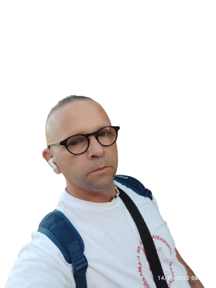

# Sobre el autor

{ align=left width="200" style="border-radius: 50%; margin-right: 2rem;" }

## Manuel Casimiro Carrasco — *Urukais*

**Desarrollador web** · Reus, Tarragona (España)

Desarrollador web con experiencia en el sector tecnológico, apasionado por construir productos digitales que combinan diseño limpio, buen rendimiento y accesibilidad.

Mi enfoque es simple: **tu visión es mi visión**. Me especializo en imaginar lo que imaginas y convertirlo en realidad. Y hacerlo bien.

 

## 🛠️ Stack tecnológico

## 🎓 Trayectoria

Mi pasión por la tecnología me llevó a formarme específicamente en desarrollo web. Durante esos años destaqué por mi dedicación y mi capacidad para resolver problemas de forma creativa. Aproveché cada oportunidad para ampliar conocimientos: proyectos propios, colaboraciones y certificaciones que complementaron mi formación.

## 🚀 Proyectos destacados

- **[Portfolio personal](https://silly-boba-dc057e.netlify.app/)** — Mi web personal con proyectos y contacto.
- **[Libro del Desarrollador Web](https://urukaisk-maker.github.io/Libro-desarrollador-Web-Urukais-/)** — Este mismo libro, construido con MkDocs Material.
- **[Urukais-musiword](https://github.com/urukaisk-maker)** — Proyecto de web musical.

## 🌍 Idiomas

- **Español** — lengua materna
- **Inglés** — nivel avanzado (colaboración con equipos internacionales)

## 🎯 Intereses

Fuera del código, disfruto de la lectura, la música y el deporte. Y siempre estoy al día con las últimas tendencias en tecnología.

## 📬 Contacto

- 🌐 **Portfolio**: [silly-boba-dc057e.netlify.app](https://silly-boba-dc057e.netlify.app/)
- 💻 **GitHub**: [@urukaisk-maker](https://github.com/urukaisk-maker)
- 📧 **Email**: urukais@example.com

## 📖 Sobre este libro

Este libro nació de mis propias notas mientras aprendía y enseñaba desarrollo web. Está pensado para ser:

- **Práctico** — cada capítulo tiene ejemplos que puedes copiar y probar.
- **Progresivo** — de lo más básico a lo más avanzado.
- **Abierto** — puedes contribuir, corregir y proponer mejoras.

---

*"La mejor forma de aprender es enseñar."*
