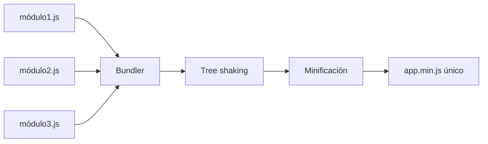

# Capítulo 13 — Módulos y bundlers

## Introducción

Durante años, todo el JavaScript de una página vivía en un solo archivo o se cargaba con múltiples etiquetas `<script>`. Aquello era un caos: colisiones de nombres, orden de carga frágil, cero encapsulación.

Los **módulos** resolvieron ese problema. Y los **bundlers** hacen que todo eso funcione de forma eficiente en producción.

## ¿Qué es un módulo?

Un módulo es un archivo que **exporta** ciertas cosas y **oculta** el resto. Solo lo que exportas es accesible desde fuera.

### Exportar

```javascript
// matematicas.js
export const PI = 3.1416;

export function sumar(a, b) {
  return a + b;
}

export default function multiplicar(a, b) {
  return a * b;
}
```

### Importar

```javascript
// app.js
import multiplicar, { PI, sumar } from './matematicas.js';

console.log(sumar(2, 3));       // 5
console.log(PI);                 // 3.1416
console.log(multiplicar(4, 5));  // 20
```

!!! info "Export default vs named"
    - **Named exports**: `export function foo() {}` → `import { foo } from './x.js'`
    - **Default export**: `export default function() {}` → `import cualquiera from './x.js'`
    
    Los **named** son más explícitos y permiten varios por archivo. Los **default** son cómodos para un único valor principal.

## Módulos en el navegador

Añade `type="module"` a tu `<script>`:

```html
<script type="module" src="app.js"></script>
```

Con eso ya puedes usar `import` / `export` sin bundler. Los navegadores modernos lo soportan.

## Import dinámico

Carga módulos **solo cuando los necesitas**:

```javascript
button.addEventListener('click', async () => {
  const { abrirModal } = await import('./modal.js');
  abrirModal();
});
```

Perfecto para *code splitting* y reducir el bundle inicial.

## El problema: demasiados archivos

En un proyecto grande tienes cientos de módulos. Pedir cada uno por separado al servidor sería lentísimo. Aquí entran los **bundlers**.

## ¿Qué es un bundler?

Un bundler:

1. Lee todos tus módulos.
2. Resuelve las dependencias.
3. Combina todo en uno o varios archivos.
4. Optimiza: minifica, elimina código muerto, aplica *tree shaking*.

Bundlers populares:

| Bundler | Cuándo usarlo |
|---|---|
| **Vite** | Proyecto moderno, rápido, el estándar hoy |
| **Webpack** | Proyectos legacy, configuraciones muy complejas |
| **Rollup** | Librerías npm |
| **esbuild** | Herramienta rápida, base de Vite |
| **Parcel** | Zero-config, proyectos pequeños |

## Vite paso a paso

### Crear un proyecto

```bash
npm create vite@latest mi-app
cd mi-app
npm install
npm run dev
```

Vite te da:

- Servidor de desarrollo ultrarrápido (HMR).
- Soporte nativo de TypeScript, JSX, CSS modules…
- Build de producción optimizado.

### Estructura típica

```
mi-app/
├── index.html
├── package.json
├── vite.config.js
└── src/
    ├── main.js
    ├── estilos.css
    └── componentes/
```

### `package.json` explicado

```json
{
  "name": "mi-app",
  "type": "module",
  "scripts": {
    "dev": "vite",
    "build": "vite build",
    "preview": "vite preview"
  },
  "devDependencies": {
    "vite": "^5.0.0"
  }
}
```

Los scripts se ejecutan con `npm run nombre`.

### `npm run dev`

Arranca el servidor de desarrollo en `http://localhost:5173`. Cada vez que guardas un archivo, el navegador se actualiza automáticamente.

### `npm run build`

Genera la carpeta `dist/` con todo optimizado:

- JavaScript minificado.
- CSS separado.
- Assets con hash (`app-a1b2c3.js`).

Ese `dist/` es lo que subes a producción.

## npm: el gestor de paquetes

### Comandos esenciales

```bash
npm init -y              # crea package.json
npm install              # instala todas las dependencias
npm install axios        # añade una dependencia
npm install -D vitest    # añade una dev-dependency
npm uninstall axios      # la quita
npm run dev              # ejecuta un script
npm outdated             # muestra paquetes desactualizados
npm update               # actualiza
```

### `dependencies` vs `devDependencies`

- **dependencies**: código que usa tu app en producción (React, axios…).
- **devDependencies**: herramientas de desarrollo (Vite, ESLint, tests…).

### `package-lock.json`

Registra las versiones exactas instaladas. **Súbelo al repo**. Garantiza que todo el equipo use las mismas.

### `.gitignore` para proyectos Node

```
node_modules/
dist/
.env
.DS_Store
```

**Nunca subas `node_modules/`**. Es enorme y se regenera con `npm install`.

## Variables de entorno con Vite

Crea un archivo `.env`:

```
VITE_API_URL=https://api.mi-app.com
```

Úsalo en código:

```javascript
const api = import.meta.env.VITE_API_URL;
```

!!! warning "No metas secretos"
    Todo lo que empiece por `VITE_` acaba en el bundle. **Nunca** pongas API keys privadas ahí. Los secretos van al backend.

## Diagrama: qué hace un bundler



El bundler combina todos los módulos, elimina el código no usado (tree shaking) y minifica el resultado en uno o varios archivos optimizados.

## Buenas prácticas

- **Un archivo, una responsabilidad**. Si un módulo hace demasiadas cosas, divídelo.
- **Named exports por defecto**. Son más fáciles de refactorizar.
- **Rutas relativas o alias**: configura `@/` para evitar `../../../`.
- **`.gitignore` siempre** con `node_modules/` y `dist/`.
- **`package-lock.json` en Git**. Es la garantía de reproducibilidad.
- **Actualiza dependencias con cabeza**. Usa `npm audit` para vulnerabilidades.
- **Analiza tu bundle** con `vite-bundle-visualizer` o `rollup-plugin-visualizer`.

## Ejercicios

1. Crea un proyecto con `npm create vite@latest` y añade un módulo propio.
2. Exporta dos funciones y un valor con named exports, e impórtalos en `main.js`.
3. Usa import dinámico para cargar un módulo solo al pulsar un botón.
4. Añade `axios` como dependencia y `vitest` como dev-dependency.
5. Configura un alias `@/` que apunte a `src/` en `vite.config.js`.
6. Genera el build con `npm run build` y examina la carpeta `dist/`.

---

⬅️ [Capítulo 12 — JavaScript asíncrono](12-javascript-asincrono.md) | ➡️ [Capítulo 14 — Accesibilidad web](14-accesibilidad.md)
git add -A ; git commit -m "feat: capítulo 13 módulos y bundlers" ; git push
---

## 🧠 Pon a prueba tus conocimientos

<div class="quiz-container" data-correct="c">
  <p class="quiz-question">¿Cuál es el bundler recomendado por defecto para nuevos proyectos hoy en día?</p>
  <div class="quiz-options">
    <button class="quiz-option" data-option="a">A) Webpack</button>
    <button class="quiz-option" data-option="b">B) Parcel</button>
    <button class="quiz-option" data-option="c">C) Vite</button>
  </div>
  <div class="quiz-feedback"></div>
</div>

<div class="quiz-container" data-correct="a">
  <p class="quiz-question">¿Qué comando se usa para instalar las dependencias de un proyecto en Node.js?</p>
  <div class="quiz-options">
    <button class="quiz-option" data-option="a">A) npm install</button>
    <button class="quiz-option" data-option="b">B) npm start</button>
    <button class="quiz-option" data-option="c">C) npm run build</button>
  </div>
  <div class="quiz-feedback"></div>
</div>