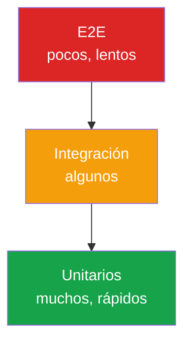

# Capítulo 16 — Testing frontend

## Introducción

El **testing** es el proceso de verificar que tu código hace lo que se supone que debe hacer. Sin tests, cada cambio es una ruleta rusa: tocas una función y rompes otra sin darte cuenta.

Los tests no son un lujo. Son la diferencia entre un proyecto que escala y uno que se vuelve inmantenible a los seis meses.

## Tipos de tests

| Tipo | Qué prueba | Velocidad | Cantidad |
|---|---|---|---|
| **Unitarios** | Una función o módulo aislado | ⚡⚡⚡ Muy rápidos | Muchos |
| **Integración** | Varios módulos juntos | ⚡⚡ Rápidos | Bastantes |
| **End-to-end (E2E)** | El flujo completo del usuario | ⚡ Lentos | Pocos |

Esta distribución se conoce como la **pirámide de testing**:

```
        /\
       /E2E\        ← pocos, lentos, costosos
      /------\
     /Integra-\     ← algunos
    /----------\
   /    Unit    \   ← muchos, rápidos, baratos
  /--------------\
```

## Herramientas modernas

| Herramienta | Uso |
|---|---|
| **Vitest** | Tests unitarios e integración (reemplazo moderno de Jest) |
| **Jest** | Clásico, ampliamente usado en React |
| **Testing Library** | Renderizar componentes y simular interacción |
| **Playwright** | E2E, multi-navegador |
| **Cypress** | E2E, muy visual |
| **MSW** | Mock de APIs a nivel de red |

!!! tip "Stack recomendado 2026"
    **Vitest + Testing Library + Playwright**. Es el combo más moderno, rápido y sencillo.

## Vitest: tu primer test

### Instalación

```bash
npm install -D vitest
```

En `package.json`:

```json
{
  "scripts": {
    "test": "vitest",
    "test:run": "vitest run",
    "test:coverage": "vitest run --coverage"
  }
}
```

### Escribir un test

```javascript
// matematicas.js
export function sumar(a, b) {
  return a + b;
}

export function esPar(n) {
  return n % 2 === 0;
}
```

```javascript
// matematicas.test.js
import { describe, it, expect } from 'vitest';
import { sumar, esPar } from './matematicas.js';

describe('sumar', () => {
  it('suma dos números positivos', () => {
    expect(sumar(2, 3)).toBe(5);
  });

  it('suma números negativos', () => {
    expect(sumar(-2, -3)).toBe(-5);
  });

  it('suma cero', () => {
    expect(sumar(0, 0)).toBe(0);
  });
});

describe('esPar', () => {
  it('devuelve true para números pares', () => {
    expect(esPar(4)).toBe(true);
    expect(esPar(0)).toBe(true);
  });

  it('devuelve false para impares', () => {
    expect(esPar(3)).toBe(false);
  });
});
```

Ejecuta:

```bash
npm test
```

## Anatomía de un test

```javascript
describe('nombre del grupo', () => {   // agrupa tests
  it('descripción concreta', () => {   // un test
    // Arrange: preparar datos
    const a = 2;
    const b = 3;

    // Act: ejecutar la acción
    const resultado = sumar(a, b);

    // Assert: comprobar el resultado
    expect(resultado).toBe(5);
  });
});
```

Patrón **AAA**: Arrange, Act, Assert.

## Aserciones comunes

```javascript
expect(valor).toBe(5);                 // igualdad estricta (===)
expect(obj).toEqual({ a: 1 });         // igualdad profunda
expect(valor).toBeTruthy();
expect(valor).toBeFalsy();
expect(array).toContain('item');
expect(array).toHaveLength(3);
expect(fn).toThrow();
expect(fn).toThrow('mensaje esperado');
expect(valor).toBeGreaterThan(10);
expect(valor).toBeNull();
expect(valor).toBeDefined();
expect(promesa).resolves.toBe(5);
expect(promesa).rejects.toThrow();
```

## `beforeEach` y `afterEach`

Limpia el estado entre tests:

```javascript
import { beforeEach, afterEach, describe, it, expect } from 'vitest';

describe('Carrito', () => {
  let carrito;

  beforeEach(() => {
    carrito = new Carrito();
  });

  afterEach(() => {
    carrito.vaciar();
  });

  it('empieza vacío', () => {
    expect(carrito.total()).toBe(0);
  });

  it('suma correctamente', () => {
    carrito.añadir({ precio: 10 });
    carrito.añadir({ precio: 5 });
    expect(carrito.total()).toBe(15);
  });
});
```

## Tests de código asíncrono

```javascript
it('carga usuarios de la API', async () => {
  const usuarios = await obtenerUsuarios();
  expect(usuarios).toHaveLength(10);
});

it('maneja errores de red', async () => {
  await expect(obtenerDeURL('https://inexistente.local'))
    .rejects.toThrow();
});
```

## Mocks y spies

### `vi.fn()` — función simulada

```javascript
import { vi, it, expect } from 'vitest';

it('llama al callback al hacer clic', () => {
  const callback = vi.fn();
  boton.addEventListener('click', callback);
  boton.click();
  expect(callback).toHaveBeenCalledTimes(1);
});
```

### `vi.spyOn()` — espiar un método existente

```javascript
const spy = vi.spyOn(console, 'log');
hacerAlgo();
expect(spy).toHaveBeenCalledWith('mensaje esperado');
spy.mockRestore();
```

### `vi.mock()` — mockear un módulo entero

```javascript
vi.mock('./api.js', () => ({
  obtenerUsuarios: vi.fn().mockResolvedValue([
    { id: 1, nombre: 'Urukais' },
  ]),
}));
```

## Testing Library: probar como un usuario

En lugar de probar detalles de implementación, Testing Library te obliga a interactuar **como lo haría una persona**.

### Instalación

```bash
npm install -D @testing-library/dom @testing-library/user-event jsdom
```

### Configuración (`vite.config.js`)

```javascript
import { defineConfig } from 'vite';

export default defineConfig({
  test: {
    environment: 'jsdom',
    globals: true,
  },
});
```

### Ejemplo con DOM

```javascript
import { screen } from '@testing-library/dom';
import userEvent from '@testing-library/user-event';
import { beforeEach, describe, it, expect } from 'vitest';

beforeEach(() => {
  document.body.innerHTML = `
    <button id="btn">Púlsame</button>
    <p id="contador">0</p>
  `;
});

it('incrementa el contador al pulsar', async () => {
  let contador = 0;
  const btn = screen.getByText('Púlsame');
  const display = document.getElementById('contador');

  btn.addEventListener('click', () => {
    contador++;
    display.textContent = contador;
  });

  await userEvent.click(btn);

  expect(display.textContent).toBe('1');
});
```

### Consultas recomendadas

En orden de prioridad (más accesible → menos):

1. `getByRole('button', { name: /enviar/i })`
2. `getByLabelText('Email')`
3. `getByPlaceholderText('tu@email.com')`
4. `getByText('Bienvenido')`
5. `getByTestId('custom-element')` ← último recurso

## Mock Service Worker (MSW)

Intercepta las peticiones HTTP a nivel de red y devuelve respuestas simuladas. Mucho más realista que mockear `fetch`.

```bash
npm install -D msw
```

```javascript
// mocks/handlers.js
import { http, HttpResponse } from 'msw';

export const handlers = [
  http.get('/api/usuarios', () => {
    return HttpResponse.json([
      { id: 1, nombre: 'Urukais' },
      { id: 2, nombre: 'Ana' },
    ]);
  }),
];
```

## Tests E2E con Playwright

### Instalación

```bash
npm install -D @playwright/test
npx playwright install
```

### Configuración (`playwright.config.js`)

```javascript
import { defineConfig } from '@playwright/test';

export default defineConfig({
  testDir: './e2e',
  use: {
    baseURL: 'http://localhost:5173',
    headless: true,
  },
  webServer: {
    command: 'npm run dev',
    port: 5173,
    reuseExistingServer: true,
  },
});
```

### Test E2E

```javascript
// e2e/login.spec.js
import { test, expect } from '@playwright/test';

test('login exitoso redirige al dashboard', async ({ page }) => {
  await page.goto('/login');
  await page.getByLabel('Email').fill('usuario@ejemplo.com');
  await page.getByLabel('Contraseña').fill('123456');
  await page.getByRole('button', { name: 'Entrar' }).click();
  await expect(page).toHaveURL('/dashboard');
  await expect(page.getByText('Bienvenido')).toBeVisible();
});

test('login fallido muestra error', async ({ page }) => {
  await page.goto('/login');
  await page.getByLabel('Email').fill('mal@ejemplo.com');
  await page.getByLabel('Contraseña').fill('incorrecta');
  await page.getByRole('button', { name: 'Entrar' }).click();
  await expect(page.getByRole('alert')).toContainText('Credenciales inválidas');
});
```

## Cobertura

```bash
npm run test:coverage
```

Genera un informe con el porcentaje de código cubierto. **No te obsesiones con el 100%.** Apunta a cubrir las rutas críticas.

## TDD: Test-Driven Development

Ciclo **Red-Green-Refactor**:

1. **Red**: escribe un test que falle.
2. **Green**: escribe el código mínimo para que pase.
3. **Refactor**: mejora el código sin romper los tests.

```javascript
// 1. Red
it('devuelve 0 para un array vacío', () => {
  expect(total([])).toBe(0);
});

// 2. Green
export function total(items) {
  return 0;
}

// 3. Refactor + siguiente test
it('suma los precios', () => {
  expect(total([{ precio: 5 }, { precio: 3 }])).toBe(8);
});

export function total(items) {
  return items.reduce((sum, item) => sum + item.precio, 0);
}
```

## CI: ejecutar tests en cada push

En `.github/workflows/test.yml`:

```yaml
name: Tests

on:
  push:
    branches: [main]
  pull_request:

jobs:
  test:
    runs-on: ubuntu-latest
    steps:
      - uses: actions/checkout@v4
      - uses: actions/setup-node@v4
        with:
          node-version: 20
          cache: npm
      - run: npm ci
      - run: npm run test:run
      - run: npx playwright install --with-deps
      - run: npx playwright test
```

## Diagrama: la pirámide de testing



Distribución recomendada: muchos tests unitarios (rápidos y baratos), algunos de integración y pocos E2E (lentos pero críticos).

## Buenas prácticas

- **Un test, una aserción conceptual**. Si tiene varias, usa `describe` para agrupar.
- **Tests independientes**. Ninguno debe depender del orden.
- **Nombres descriptivos**. `it('devuelve 0 para un array vacío')` mejor que `it('total')`.
- **Prueba el comportamiento**, no la implementación. Si refactorizas sin cambiar la API, los tests deben seguir pasando.
- **Usa Testing Library** para el DOM. Te obliga a escribir accesible.
- **Mocks con moderación**. Si necesitas mockear todo, el diseño tiene un problema.
- **Tests rápidos**. Si tardan minutos, no los ejecutarás.
- **Cubre rutas críticas**: login, checkout, formularios principales.
- **Ejecuta tests en CI** antes de cada merge.

## Ejercicios

1. Escribe tests unitarios para una función `formatearPrecio(n)`.
2. Cubre con Vitest una función `validarEmail(email)`.
3. Escribe un test con Testing Library que rellene y envíe un formulario.
4. Mockea una API con MSW y prueba un componente que la consume.
5. Escribe un test E2E con Playwright para el flujo "buscar producto → añadir al carrito".
6. Configura `npm run test:coverage` y analiza el informe.
7. Añade un workflow de GitHub Actions que ejecute los tests en cada PR.

---

⬅️ [Capítulo 15 — TypeScript desde cero](15-typescript.md) | ➡️ [Capítulo 17 — Rendimiento web](17-rendimiento.md)
---
### 🧪 Laboratorio en Vivo: Testing con Vitest

Ejecuta tests reales en el navegador sin instalar nada.

<a href="https://stackblitz.com/fork/vitest" target="_blank" class="md-button md-button--primary">🧪 Abrir laboratorio Vitest</a>
## 🧠 Pon a prueba tus conocimientos

<div class="quiz-container" data-correct="b">
  <p class="quiz-question">¿Qué tipo de test comprueba una función o módulo de forma aislada?</p>
  <div class="quiz-options">
    <button class="quiz-option" data-option="a">A) Test E2E</button>
    <button class="quiz-option" data-option="b">B) Test Unitario</button>
    <button class="quiz-option" data-option="c">C) Test de Integración</button>
  </div>
  <div class="quiz-feedback"></div>
</div>

<div class="quiz-container" data-correct="a">
  <p class="quiz-question">¿Qué significa TDD?</p>
  <div class="quiz-options">
    <button class="quiz-option" data-option="a">A) Test-Driven Development</button>
    <button class="quiz-option" data-option="b">B) Total Data Debugging</button>
    <button class="quiz-option" data-option="c">C) Test Data Deployment</button>
  </div>
  <div class="quiz-feedback"></div>
</div>