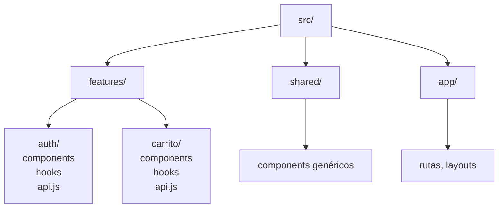

# Capítulo 18 — Arquitectura frontend

## Introducción

Escribir componentes funciona. Pero cuando el proyecto crece a decenas de miles de líneas, necesitas **arquitectura**: decisiones conscientes sobre cómo se organiza el código, cómo fluye el estado y cómo se comunican las partes.

Este capítulo repasa los patrones y principios que separan un proyecto amateur de uno profesional.

## ¿Qué es la arquitectura frontend?

Es el conjunto de decisiones sobre:

- **Estructura de carpetas** y módulos.
- **Gestión del estado** (local, global, servidor).
- **Comunicación entre componentes**.
- **Separación de responsabilidades**.
- **Escalabilidad** del código y del equipo.

Una buena arquitectura hace que añadir una feature sea trivial. Una mala hace que cada cambio rompa tres cosas.

## Principios fundamentales

### 1. Separación de responsabilidades

Cada módulo debe tener **una única razón para cambiar**.

- **UI**: cómo se ve.
- **Lógica de negocio**: qué hace.
- **Datos**: de dónde vienen.

### 2. Bajo acoplamiento, alta cohesión

- **Bajo acoplamiento**: los módulos dependen lo mínimo posible entre sí.
- **Alta cohesión**: todo lo relacionado vive junto.

### 3. Composición sobre herencia

Prefiere componer piezas pequeñas que heredar de clases gigantes.

### 4. DRY, pero no demasiado

*Don't Repeat Yourself*. Pero **duplicar dos veces es mejor que abstraer mal**. La regla de tres: abstrae cuando se repita tres veces.

### 5. KISS y YAGNI

- **KISS**: *Keep It Simple*.
- **YAGNI**: *You Aren't Gonna Need It*. No construyas para necesidades hipotéticas.

## Estructura de carpetas

### Por tipo (feature-first vs type-first)

**Type-first** (agrupa por tipo de archivo):

```
src/
├── components/
├── hooks/
├── utils/
├── services/
└── types/
```

Ventaja: simple al principio. Problema: en proyectos grandes, `components/` acaba con 200 archivos.

**Feature-first** (agrupa por funcionalidad):

```
src/
├── features/
│   ├── auth/
│   │   ├── components/
│   │   ├── hooks/
│   │   ├── api.js
│   │   └── index.js
│   ├── carrito/
│   └── productos/
├── shared/
│   ├── components/
│   ├── hooks/
│   └── utils/
└── app/
```

Ventaja: cada feature es autónoma. Problema: hay que decidir qué es "compartido".

!!! tip "Recomendación"
    Empieza simple. Cuando el proyecto crezca, migra a **feature-first**. No lo hagas antes.

### Estructura recomendada para empezar

```
src/
├── app/            # configuración global, rutas, providers
├── components/     # componentes reutilizables
├── features/       # funcionalidades de negocio
├── hooks/          # hooks compartidos
├── lib/            # utilidades, helpers
├── services/       # llamadas a APIs
├── styles/         # estilos globales
└── types/          # tipos compartidos
```

## Estado: el gran problema

El estado es lo más complicado en frontend. Hay que distinguir **tres tipos**:

| Tipo | Ejemplo | Dónde vive |
|---|---|---|
| **Local** | input abierto/cerrado | Componente |
| **Global** | usuario logueado, tema | Store global o contexto |
| **Servidor** | lista de productos, posts | Caché de datos del servidor |

!!! warning "Error común"
    Meter **estado del servidor** en un store global es un antipatrón. Usa herramientas especializadas (React Query, SWR, Apollo) que gestionan caché, invalidación y sincronización.

## Estado local

Empieza siempre por aquí. Un estado es local si:

- Solo lo usa un componente o su descendencia directa.
- No necesita persistir.
- No lo comparte con otras partes de la app.

```javascript
function Modal() {
  const [abierto, setAbierto] = useState(false);
  // ...
}
```

## Elevación del estado

Si dos componentes hermanos lo necesitan, súbelo al padre común.

```javascript
function Padre() {
  const [valor, setValor] = useState('');
  return (
    <>
      <Input valor={valor} onChange={setValor} />
      <Preview valor={valor} />
    </>
  );
}
```

## Contexto (React) / Provide-Inject (Vue)

Para estado global ligero (tema, idioma, usuario).

```jsx
const TemaContext = createContext();

function App() {
  const [tema, setTema] = useState('claro');
  return (
    <TemaContext.Provider value={{ tema, setTema }}>
      <Layout />
    </TemaContext.Provider>
  );
}

function Boton() {
  const { tema, setTema } = useContext(TemaContext);
  // ...
}
```

!!! warning "Cuándo NO usar contexto"
    El contexto no es un store. Cada cambio en el provider re-renderiza a **todos** los consumidores. Para estado complejo, usa una librería dedicada.

## Stores modernos

| Librería | Filosofía |
|---|---|
| **Zustand** | Minimalista, hooks, sin boilerplate |
| **Redux Toolkit** | Estructurado, DevTools, muy testeable |
| **Pinia** | El estándar para Vue 3 |
| **Jotai** | Atómico, granular |
| **Valtio** | Proxy-based, mutable |

### Zustand en 30 líneas

```javascript
import { create } from 'zustand';

export const useCarrito = create((set) => ({
  items: [],
  añadir: (producto) => set((state) => ({
    items: [...state.items, producto],
  })),
  vaciar: () => set({ items: [] }),
  total: () => useCarrito.getState().items.reduce(
    (sum, item) => sum + item.precio, 0
  ),
}));

// En un componente
function Carrito() {
  const { items, añadir } = useCarrito();
  // ...
}
```

## Estado del servidor

Para datos que vienen de APIs, usa una librería que gestione:

- **Caché** automática.
- **Revalidación** en segundo plano.
- **Invalidación** tras mutaciones.
- **Reintentos** con backoff.

```javascript
// React Query / TanStack Query
function Productos() {
  const { data, isLoading, error } = useQuery({
    queryKey: ['productos'],
    queryFn: () => fetch('/api/productos').then(r => r.json()),
    staleTime: 5 * 60 * 1000,
  });

  if (isLoading) return <Spinner />;
  if (error) return <Error mensaje={error.message} />;
  return <Lista items={data} />;
}
```

## Patrones de componentes

### Container / Presentational

- **Presentational**: solo UI. Recibe props, emite eventos. Sin lógica.
- **Container**: maneja datos, efectos, estado. Delega el render.

En React moderno esto se hace con **hooks** en lugar de clases.

### Compound components

Componentes que trabajan juntos y comparten estado implícito.

```jsx
<Tabs defaultValue="perfil">
  <Tabs.List>
    <Tabs.Trigger value="perfil">Perfil</Tabs.Trigger>
    <Tabs.Trigger value="cuenta">Cuenta</Tabs.Trigger>
  </Tabs.List>
  <Tabs.Panel value="perfil">...</Tabs.Panel>
  <Tabs.Panel value="cuenta">...</Tabs.Panel>
</Tabs>
```

Los hijos se comunican a través del contexto del padre.

### Render props / Slots

Delegan el render de parte del componente al consumidor.

```jsx
<Modal
  trigger={<button>Abrir</button>}
  content={({ cerrar }) => <p>Contenido <button onClick={cerrar}>Cerrar</button></p>}
/>
```

### HOC (Higher-Order Component)

Función que envuelve un componente y le añade funcionalidad.

```jsx
const ConAutenticacion = (Componente) => (props) => {
  const { usuario } = useAuth();
  if (!usuario) return <Login />;
  return <Componente {...props} usuario={usuario} />;
};

export const Perfil = ConAutenticacion(({ usuario }) => (
  <h1>Hola, {usuario.nombre}</h1>
));
```

En React moderno se prefieren hooks, pero siguen siendo útiles en algunas librerías.

## Comunicación entre módulos

### Props / eventos

El mecanismo más simple. Ideal para relaciones padre-hijo.

### Estado compartido

Para componentes distantes en el árbol.

### Bus de eventos

Útil para comunicación **desacoplada** entre features que no deberían conocerse.

```javascript
const bus = new EventTarget();

// Emisor
bus.dispatchEvent(new CustomEvent('carrito:add', { detail: producto }));

// Receptor
bus.addEventListener('carrito:add', (e) => {
  actualizarContador(e.detail);
});
```

## Código compartido: el problema del "shared"

Cuando algo se usa en dos features, la tentación es moverlo a `shared/`. Pero cuidado:

- **Duplicar dos veces es aceptable**. Abstraer mal es peor.
- **Solo sube a `shared/` cuando sea genérico y estable**.
- **`shared/` no debe importar nada de `features/`**.

```javascript
// ❌ Mal: shared/ importa de features/
// src/shared/utils.js
import { formatearCarrito } from '../features/carrito/formato.js';

// ✅ Bien: shared/ es independiente
// src/shared/utils.js
export function formatearPrecio(n) {
  return new Intl.NumberFormat('es-ES', {
    style: 'currency',
    currency: 'EUR',
  }).format(n);
}
```

## Rutas y layouts

Separar **layout** (estructura) de **página** (contenido).

```
src/app/
├── rutas.js
├── layouts/
│   ├── Principal.jsx
│   └── Autenticado.jsx
└── paginas/
    ├── Inicio.jsx
    ├── Perfil.jsx
    └── Login.jsx
```

## Lazy loading de rutas

Divide el bundle por ruta para cargar solo lo necesario.

```jsx
const Productos = lazy(() => import('./paginas/Productos'));
const Perfil = lazy(() => import('./paginas/Perfil'));

<Routes>
  <Route path="/productos" element={
    <Suspense fallback={<Cargando />}>
      <Productos />
    </Suspense>
  } />
  <Route path="/perfil" element={
    <Suspense fallback={<Cargando />}>
      <Perfil />
    </Suspense>
  } />
</Routes>
```

## Convenciones y estilo

- **Nombres consistentes**: `PascalCase` para componentes, `camelCase` para funciones/variables.
- **Un componente por archivo**. Nombres descriptivos.
- **Imports ordenados**: externos → internos → estilos.
- **Barrel files (`index.js`) con moderación**. Pueden crear ciclos.
- **ESLint + Prettier** configurados desde el día 1.
- **TypeScript en proyectos grandes** (ayuda muchísimo a la arquitectura).

## Testing de arquitectura

- **Tests unitarios**: funciones puras, hooks, utilidades.
- **Tests de integración**: feature completa (componente + store + API mockeada).
- **Tests E2E**: flujos del usuario.

Los tests siguen la estructura **feature-first**:

```
src/features/carrito/
├── components/
├── hooks/
├── api.js
├── carrito.test.js       ← test de la feature
└── __fixtures__/
```

## Monorepos

Cuando tienes varias apps (web, admin, mobile) que comparten código, un monorepo ayuda.

Herramientas: **Turborepo**, **Nx**, **pnpm workspaces**.

```
mi-monorepo/
├── apps/
│   ├── web/
│   ├── admin/
│   └── mobile/
└── packages/
    ├── ui/            # componentes compartidos
    ├── utils/         # helpers
    └── config/        # eslint, tsconfig
```

## Diagrama: estructura feature-first



En feature-first cada funcionalidad es autónoma. `shared/` contiene lo reutilizable y **nunca** importa de `features/`.

## Buenas prácticas

- **Empieza simple**. No adoptes arquitectura compleja hasta que sea necesaria.
- **Separa estado local, global y del servidor**. No los mezcles.
- **Feature-first** cuando el proyecto crece.
- **`shared/` no importa de `features/`**. Nunca.
- **Bajo acoplamiento**. Dos features no deberían conocerse.
- **Composición sobre herencia**.
- **TypeScript** en proyectos medianos o grandes.
- **Convenciones claras** y respetadas por todo el equipo.
- **Refactoriza sin miedo**. Los tests te cubren.
- **Documenta las decisiones** importantes (ADR — Architecture Decision Records).

## Ejercicios

1. Reorganiza un proyecto tuyo de `type-first` a `feature-first`.
2. Identifica tres estados en tu app y clasifícalos (local, global, servidor).
3. Sustituye un store global con estado del servidor por React Query (o similar).
4. Escribe un componente `Tabs` con el patrón compound components.
5. Configura lazy loading por rutas.
6. Añade TypeScript a un proyecto JavaScript pequeño.
7. Escribe un ADR para una decisión arquitectónica reciente.
8. Audita tus imports: ¿`shared/` importa de `features/`?

---

⬅️ [Capítulo 17 — Rendimiento web](17-rendimiento.md) | ➡️ Apéndices (chuletas, glosario, recursos por nivel)
