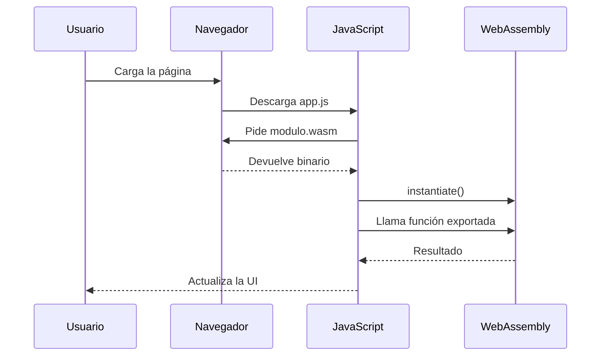

# Capítulo 27 — WebAssembly

## Introducción

**WebAssembly** (Wasm) es un formato binario que se ejecuta en el navegador a velocidades cercanas al código nativo. Es un complemento a JavaScript, no un sustituto.

Lo usan Figma, AutoCAD Web, Google Earth, Photoshop Web, y cualquier aplicación que necesite rendimiento extremo en el navegador.

## ¿Qué es exactamente?

Wasm es:

- **Un formato binario** — compacto, rápido de descargar.
- **Un estándar abierto** — soportado por todos los navegadores modernos.
- **Multi-lenguaje** — puedes compilar desde C, C++, Rust, Go, Zig…
- **Sandboxed** — se ejecuta en un entorno seguro, sin acceso directo al sistema.

No es:

- Un reemplazo de JavaScript.
- Un lenguaje que escribas a mano (normalmente se compila).
- Solo para juegos.

## ¿Cuándo usar WebAssembly?

### ✅ Buen caso

- **Cálculos intensivos**: procesamiento de imagen, vídeo, criptografía.
- **Portar código existente**: apps de escritorio en C++ al navegador.
- **Juegos y simulaciones**.
- **Edición de audio/vídeo en tiempo real**.
- **Machine learning en el navegador**.

### ❌ Mal caso

- Manipulación del DOM (usa JavaScript).
- Lógica de negocio simple.
- Formularios, navegación, UI.
- Cuando ya funciona bien con JS.

!!! tip "Regla práctica"
    Si no tienes un problema de rendimiento medido, **no necesitas WebAssembly**. JS es rapidísimo para el 99% de casos.

## Cómo funciona

```
Código fuente (Rust/C/C++)
        ↓
   Compilador (wasm-pack, emscripten, etc.)
        ↓
   archivo .wasm (binario)
        ↓
   Cargado en el navegador
        ↓
   Ejecutado junto a JavaScript
```

Desde JavaScript se carga y ejecuta así:

```javascript
const respuesta = await fetch('modulo.wasm');
const buffer = await respuesta.arrayBuffer();
const modulo = await WebAssembly.instantiate(buffer);
const resultado = modulo.instance.exports.sumar(2, 3);
console.log(resultado); // 5
```

## Ejemplo: compilar Rust a WebAssembly

### Instalar herramientas

```bash
curl --proto '=https' --tlsv1.2 -sSf https://sh.rustup.rs | sh
cargo install wasm-pack
```

### Crear un proyecto

```bash
cargo new --lib mi-wasm
cd mi-wasm
```

Edita `Cargo.toml`:

```toml
[package]
name = "mi-wasm"
version = "0.1.0"
edition = "2021"

[lib]
crate-type = ["cdylib"]

[dependencies]
wasm-bindgen = "0.2"
```

### Escribir la función

```rust
use wasm_bindgen::prelude::*;

#[wasm_bindgen]
pub fn fibonacci(n: u32) -> u64 {
    match n {
        0 => 0,
        1 => 1,
        _ => {
            let mut a = 0u64;
            let mut b = 1u64;
            for _ in 2..=n {
                let t = a + b;
                a = b;
                b = t;
            }
            b
        }
    }
}

#[wasm_bindgen]
pub fn sumar_array(numeros: &[i32]) -> i32 {
    numeros.iter().sum()
}
```

### Compilar

```bash
wasm-pack build --target web
```

Genera una carpeta `pkg/` con el `.wasm`, un `.js` de pegamento y un `.d.ts`.

### Usar en JavaScript

```html
<!DOCTYPE html>
<html lang="es">
<head>
  <meta charset="UTF-8">
  <title>Wasm demo</title>
</head>
<body>
  <p>Fibonacci(40) = <span id="resultado"></span></p>

  <script type="module">
    import init, { fibonacci } from './pkg/mi_wasm.js';

    await init();
    const inicio = performance.now();
    const resultado = fibonacci(40);
    const fin = performance.now();
    document.getElementById('resultado').textContent =
      `${resultado} (${(fin - inicio).toFixed(2)} ms)`;
  </script>
</body>
</html>
```

## Comparativa de rendimiento

Caso real: calcular 1 millón de números primos.

| Tecnología | Tiempo |
|---|---|
| JavaScript puro | ~850 ms |
| WebAssembly (Rust) | ~120 ms |
| WebAssembly (C++) | ~110 ms |

**7-8× más rápido**. Pero ojo: la carga inicial del `.wasm` añade latencia. Para tareas pequeñas, JS gana.

## Emscripten (C/C++ a Wasm)

Si tienes código en C o C++, usa **Emscripten**:

```bash
git clone https://github.com/emscripten-core/emsdk.git
cd emsdk
./emsdk install latest
./emsdk activate latest
source ./emsdk_env.sh
```

Compilar:

```bash
emcc mi_programa.c -o mi_programa.js -s WASM=1 -O3
```

Genera `mi_programa.wasm` + `mi_programa.js`.

## WASI: WebAssembly fuera del navegador

**WASI** (WebAssembly System Interface) permite ejecutar Wasm en el servidor, la terminal o el edge. Es el futuro de la portabilidad.

Casos de uso:

- **Cloudflare Workers** — funciones en el edge.
- **Fastly Compute@Edge**.
- **Fermyon Spin** — microservicios.
- **Docker + Wasm** — contenedores más ligeros.

## Aplicaciones reales

- **Figma** — renderizado de vectores.
- **AutoCAD Web** — CAD completo en el navegador.
- **Google Earth** — 3D global.
- **Photoshop Web** — edición de imagen.
- **Amazon Prime Video** — decodificación.
- **Zoom Web** — procesamiento de audio/vídeo.

## Limitaciones

- **No accede directamente al DOM** (hay que pasar por JavaScript).
- **Tamaño del binario** — puede ser grande si no se optimiza.
- **Debugging complicado** — aunque mejora cada año.
- **No reemplaza a JS** — se complementan.

## Diagrama: cómo se ejecuta un módulo Wasm



JavaScript orquesta la carga y llama a las funciones de WebAssembly. El código pesado se ejecuta dentro del módulo Wasm a velocidad casi nativa.

## Buenas prácticas

- **Mide antes**. Solo usa Wasm si JS no es suficiente.
- **Usa `wasm-pack`** para Rust.
- **Optimiza el tamaño** con `-O3` y `wasm-opt`.
- **Carga diferida**: no bloquees el arranque con el `.wasm`.
- **Comparte memoria** con `SharedArrayBuffer` si necesitas hilos.
- **Usa Web Workers** para no bloquear el hilo principal.
- **Cachea el `.wasm`** con Cache Storage.
- **Prueba en móvil**. El rendimiento varía mucho.

## Ejemplo real: procesar imágenes

```rust
use wasm_bindgen::prelude::*;
use image::{DynamicImage, ImageOutputFormat};

#[wasm_bindgen]
pub fn escala_grises(bytes: &[u8]) -> Vec<u8> {
    let img = image::load_from_memory(bytes).unwrap();
    let gris = img.grayscale();
    let mut salida = Vec::new();
    gris.write_to(&mut salida, ImageOutputFormat::Png).unwrap();
    salida
}
```

En JavaScript:

```javascript
import init, { escala_grises } from './pkg/mi_wasm.js';
await init();

const input = document.querySelector('input[type=file]');
input.addEventListener('change', async (e) => {
  const file = e.target.files[0];
  const bytes = new Uint8Array(await file.arrayBuffer());
  const resultado = escala_grises(bytes);
  const blob = new Blob([resultado], { type: 'image/png' });
  document.querySelector('img').src = URL.createObjectURL(blob);
});
```

## Ejercicios

1. Compila una función de Fibonacci a Wasm con Rust y compárala con JS.
2. Usa `wasm-pack` para crear un paquete npm con tu módulo.
3. Porta una función intensiva de tu proyecto a Wasm y mide la mejora.
4. Prueba un módulo Wasm desde Cloudflare Workers.
5. Escribe el mismo algoritmo en JS y en Rust, compara el rendimiento.
6. Añade un Web Worker que ejecute el módulo Wasm en segundo plano.

---

⬅️ [Capítulo 26 — Seguridad web](26-seguridad.md) | ➡️ [Capítulo 28 — IA en el frontend](28-ia-frontend.md)
---

## 🧠 Pon a prueba tus conocimientos

<div class="quiz-container" data-correct="c">
  <p class="quiz-question">¿Qué es WebAssembly (Wasm)?</p>
  <div class="quiz-options">
    <button class="quiz-option" data-option="a">A) Un framework de JavaScript</button>
    <button class="quiz-option" data-option="b">B) Un reemplazo total de JavaScript</button>
    <button class="quiz-option" data-option="c">C) Un formato binario para ejecutar código a alta velocidad en el navegador</button>
  </div>
  <div class="quiz-feedback"></div>
</div>

<div class="quiz-container" data-correct="b">
  <p class="quiz-question">¿Qué lenguaje es ideal para compilar a WebAssembly?</p>
  <div class="quiz-options">
    <button class="quiz-option" data-option="a">A) Python</button>
    <button class="quiz-option" data-option="b">B) Rust o C++</button>
    <button class="quiz-option" data-option="c">C) HTML</button>
  </div>
  <div class="quiz-feedback"></div>
</div>