# 📊 Diagrams Gallery

!!! quote "Visualize what you learn"
    All visual diagrams from the book gathered on a single page. Each one accompanies a chapter and helps you grasp complex concepts at a glance.

!!! tip "How they are built"
    All diagrams are written in [Mermaid](https://mermaid.js.org/), a text-based diagramming language. They render automatically in the browser, adapt to light/dark mode, and can be version-controlled in Git.

---

## 🧭 Table of Contents

- [How the web works](#1-how-the-web-works)
- [Git workflow](#2-git-workflow)
- [CSS cascade layers](#3-css-cascade-layers)
- [What a bundler does](#4-what-a-bundler-does)
- [Testing pyramid](#5-testing-pyramid)
- [Feature-first structure](#6-feature-first-structure)
- [Full-stack architecture](#7-full-stack-architecture)
- [How a Service Worker works](#8-how-a-service-worker-works)
- [HTTP vs WebSocket](#9-http-vs-websocket)
- [Rendering pipeline](#10-rendering-pipeline)
- [Security layers](#11-security-layers)
- [How WebAssembly runs](#12-how-webassembly-runs)
- [WebXR architecture](#13-webxr-architecture)
- [How a dApp interacts](#14-how-a-dapp-interacts)

---

## 1. How the Web Works

[View in the original chapter](capitulos/01-introduccion.md)

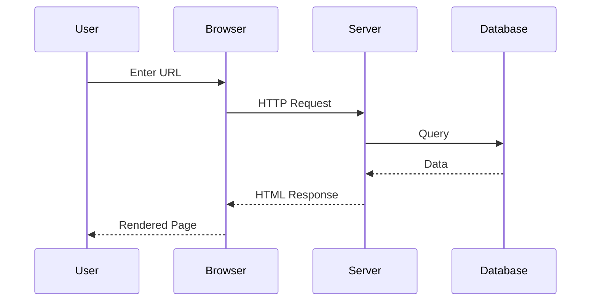

**Explanation**: the basic flow of any web application. The user makes a request, the server queries the database, and returns the rendered HTML.

---

## 2. Git Workflow

[View in the original chapter](capitulos/07-git.md)

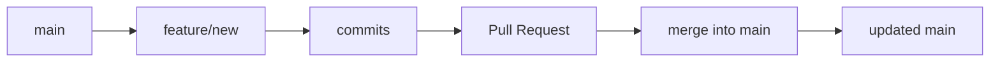

**Explanation**: a typical team Git workflow. You create a branch, make commits, open a Pull Request, and merge into main after review.

---

## 3. CSS Cascade Layers

[View in the original chapter](capitulos/11-css-moderno.md)

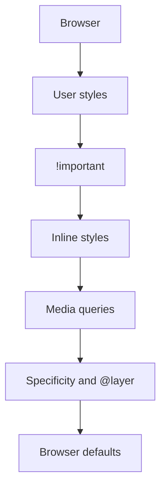

**Explanation**: the priority order of the CSS cascade, from lowest to highest. Browser defaults are weakest; !important is strongest.

---

## 4. What a Bundler Does

[View in the original chapter](capitulos/13-modulos-bundlers.md)

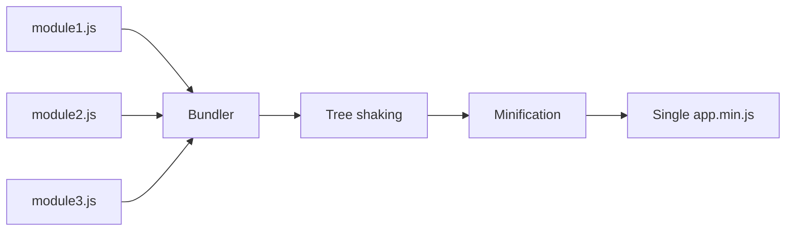

**Explanation**: a bundler (Vite, Webpack, esbuild) takes all modules, removes unused code (tree shaking), minifies, and outputs a single optimized bundle.

---

## 5. Testing Pyramid

[View in the original chapter](capitulos/16-testing.md)

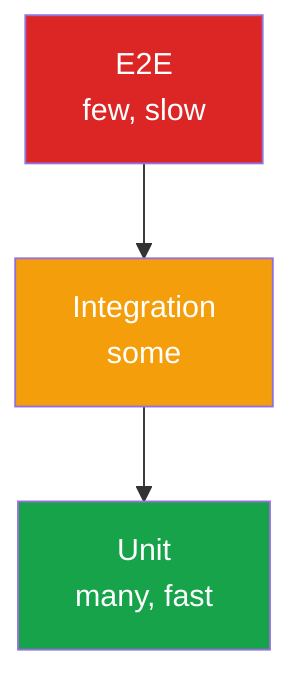

**Explanation**: the classic testing pyramid. Many unit tests (fast), some integration tests, a few E2E tests (slow).

---

## 6. Feature-First Structure

[View in the original chapter](capitulos/18-arquitectura.md)

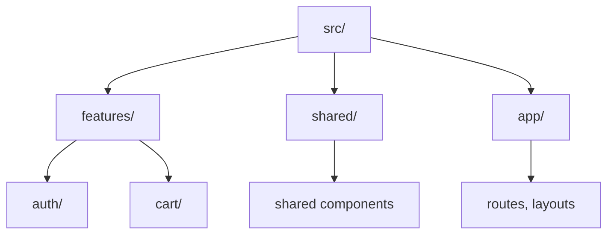

**Explanation**: in feature-first architectures, each feature lives in its own folder with everything it needs.

---

## 7. Full-Stack Architecture

[View in the original chapter](capitulos/19-fullstack-node.md)

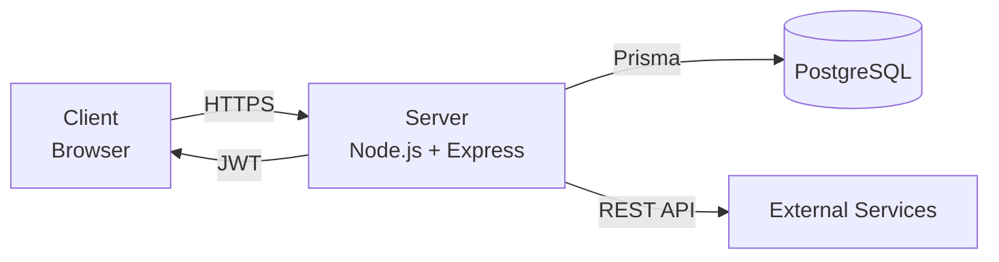

**Explanation**: a typical full-stack architecture with Node.js + Express, PostgreSQL database, JWT authentication, and connections to external services.

---

## 8. How a Service Worker Works

[View in the original chapter](capitulos/22-pwa.md)

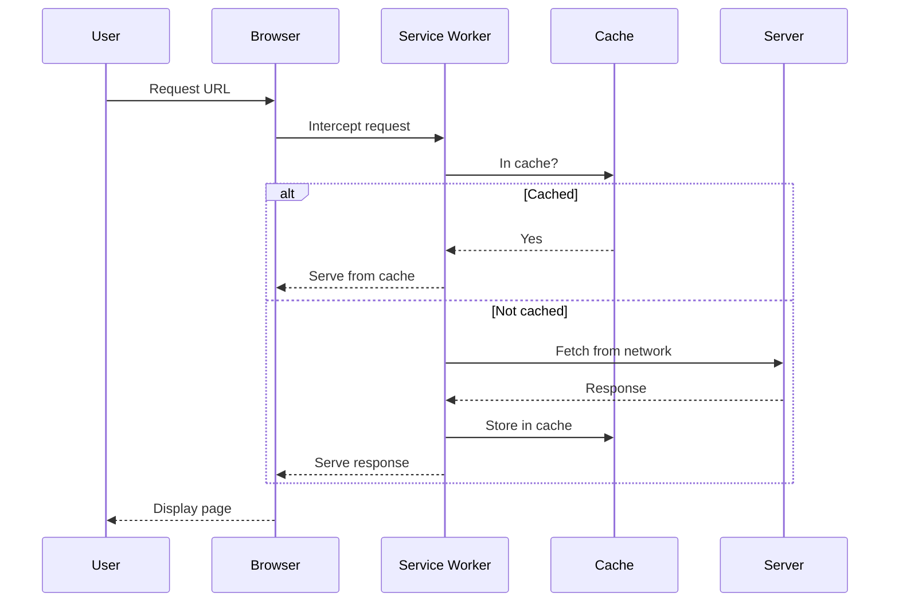

**Explanation**: the Service Worker intercepts requests and decides whether to serve from cache (fast, offline) or from the network.

---

## 9. HTTP vs WebSocket

[View in the original chapter](capitulos/23-websockets.md)

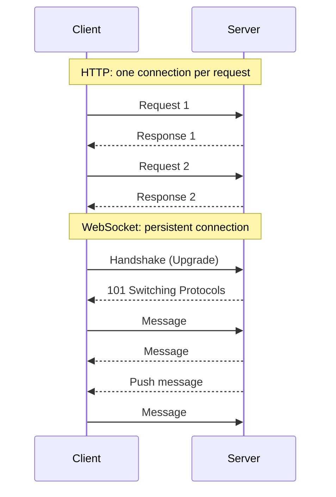

**Explanation**: HTTP opens a new connection per request. WebSocket opens a persistent, bidirectional connection.

---

## 10. Rendering Pipeline

[View in the original chapter](capitulos/24-animaciones.md)

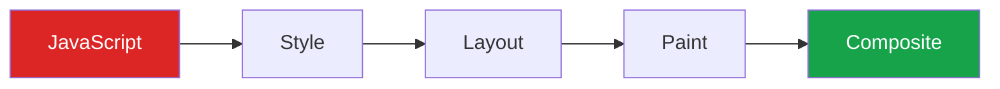

**Explanation**: when JavaScript changes something, the browser recalculates styles, layout, paint, and composite. Animations using transform and opacity skip layout and paint.

---

## 11. Security Layers

[View in the original chapter](capitulos/26-seguridad.md)

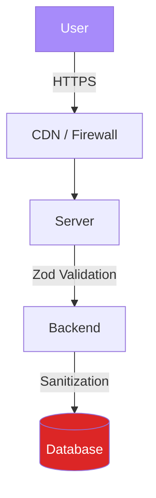

**Explanation**: security is defense in depth. HTTPS in transit, firewall/CDN at the edge, input validation in the backend, sanitization before saving.

---

## 12. How WebAssembly Runs

[View in the original chapter](capitulos/27-webassembly.md)

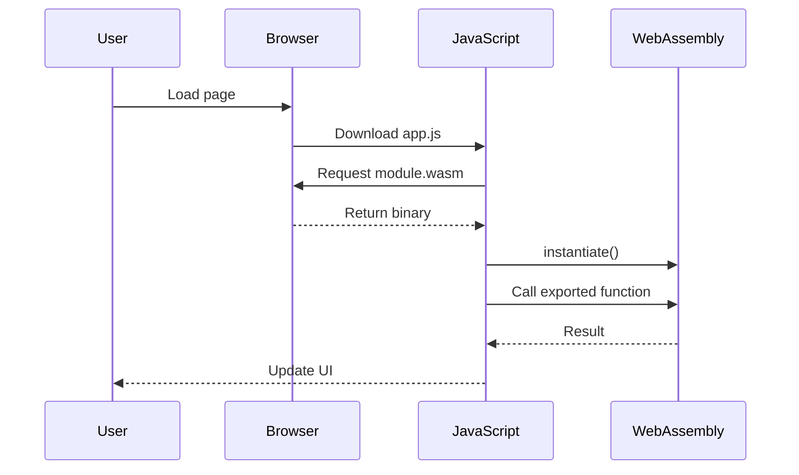

**Explanation**: JavaScript fetches the .wasm binary, instantiates it, and calls exported functions.

---

## 13. WebXR Architecture

[View in the original chapter](capitulos/29-webxr.md)

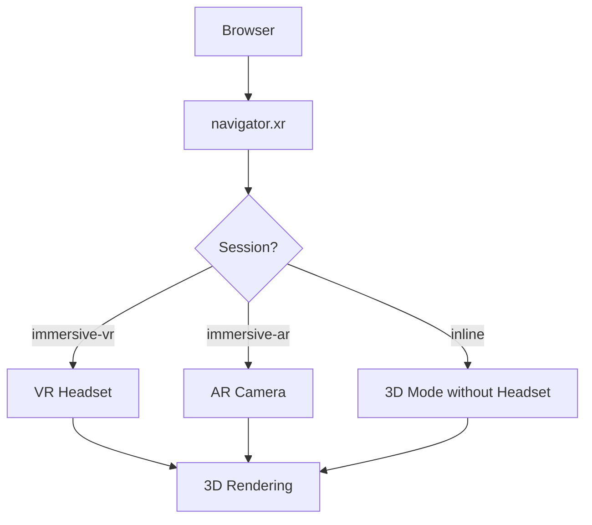

**Explanation**: WebXR exposes navigator.xr, letting you request VR, AR, or inline 3D sessions.

---

## 14. How a dApp Interacts

[View in the original chapter](capitulos/30-web3.md)

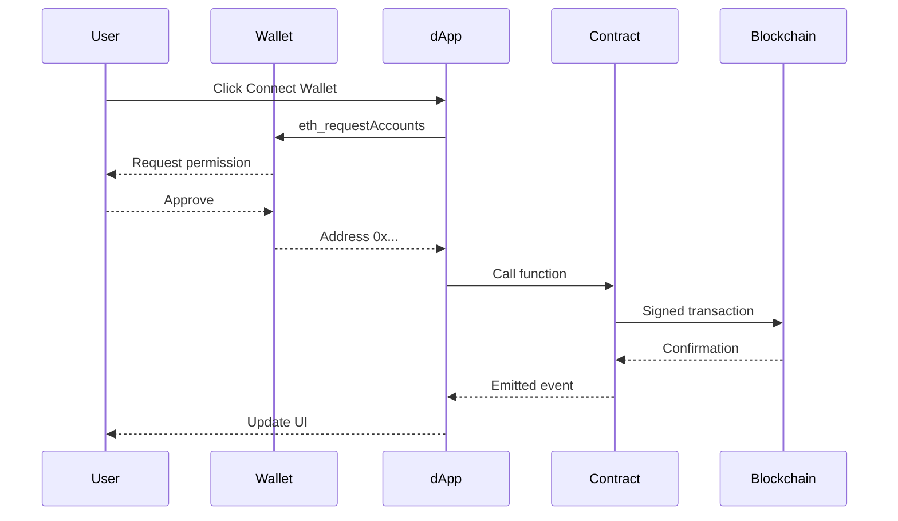

**Explanation**: a dApp connects to the user's wallet, which signs transactions. The transaction travels to the blockchain and the dApp updates the UI.

---

## 🛠 How These Diagrams Are Made

All of them are written in **Mermaid**, a language for describing diagrams with plain text. MkDocs Material renders them automatically when building the site.

**Benefits:**

- **Version-controllable** in Git as text.
- **Editable** by anyone.
- **No images** to update manually.
- **Adapts** to the site's light and dark modes.

Learn more: [mermaid.js.org](https://mermaid.js.org/)

---

## ➡ Next Steps

[📖 Back to index](index.md){ .md-button .md-button--primary }
[🎯 View weekly challenges](retos.md){ .md-button }
[✅ View solved exercises](ejercicios/index.md){ .md-button }