# Galería de diagramas

Todos los diagramas visuales del libro, recopilados en una sola página.

!!! tip "Cómo están hechos"
    Todos los diagramas están hechos con [Mermaid](https://mermaid.js.org/), un lenguaje de diagramas basado en texto. Se renderizan automáticamente en el navegador.

## 1. Cómo funciona la web

[Ver en el capítulo original](capitulos/01-introduccion.md)

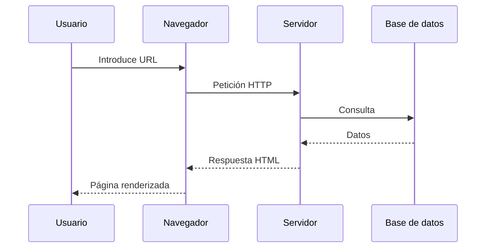

## 2. Flujo de trabajo con Git

[Ver en el capítulo original](capitulos/07-git.md)

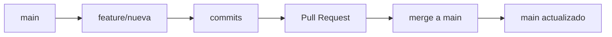

## 3. Capas de la cascada CSS

[Ver en el capítulo original](capitulos/11-css-moderno.md)

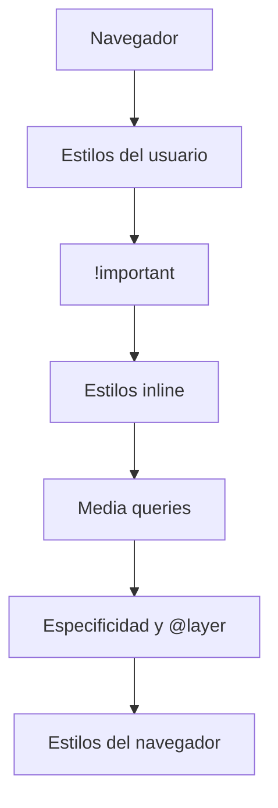

## 4. Qué hace un bundler

[Ver en el capítulo original](capitulos/13-modulos-bundlers.md)

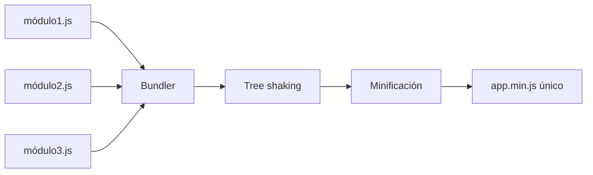

## 5. Pirámide de testing

[Ver en el capítulo original](capitulos/16-testing.md)

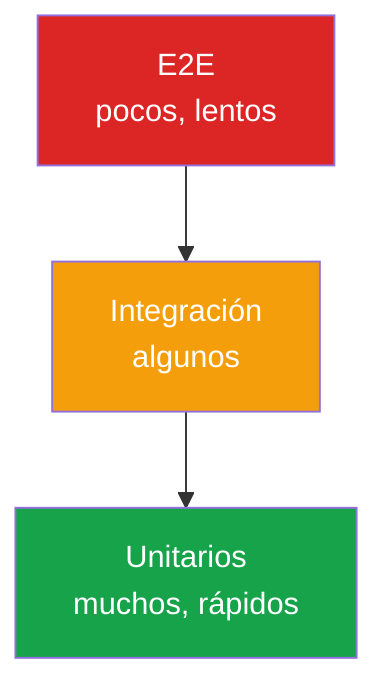

## 6. Estructura feature-first

[Ver en el capítulo original](capitulos/18-arquitectura.md)

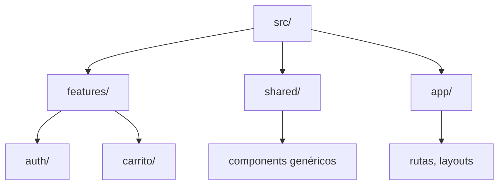

## 7. Arquitectura full-stack

[Ver en el capítulo original](capitulos/19-fullstack-node.md)

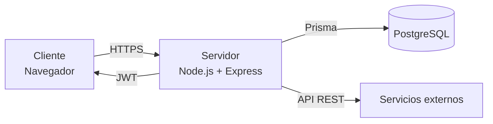

## 8. Cómo funciona un Service Worker

[Ver en el capítulo original](capitulos/22-pwa.md)

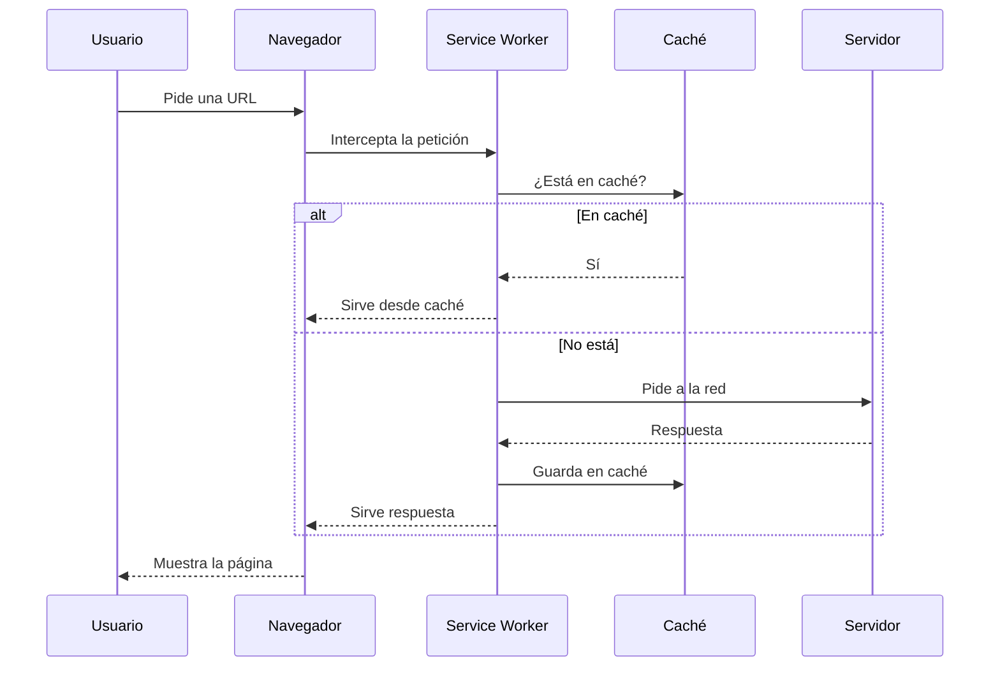

## 9. HTTP vs WebSocket

[Ver en el capítulo original](capitulos/23-websockets.md)

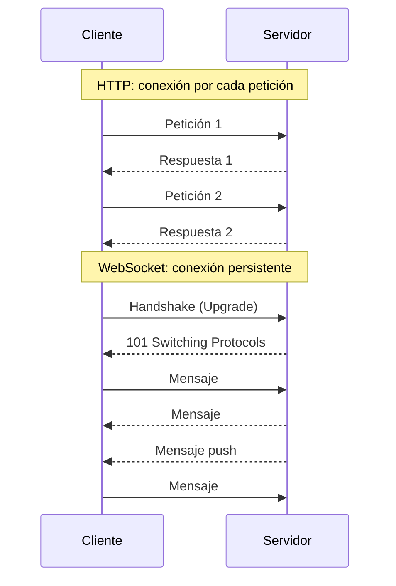

## 10. Pipeline de renderizado

[Ver en el capítulo original](capitulos/24-animaciones.md)

## 11. Capas de seguridad

[Ver en el capítulo original](capitulos/26-seguridad.md)

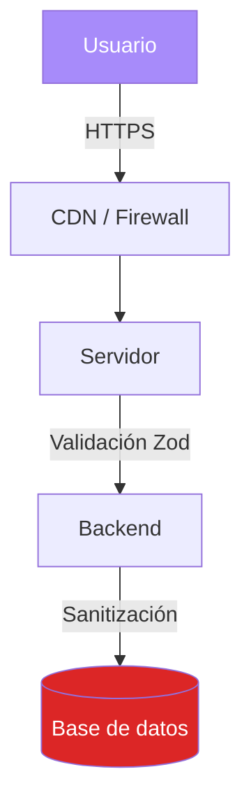

## 12. Cómo se ejecuta WebAssembly

[Ver en el capítulo original](capitulos/27-webassembly.md)

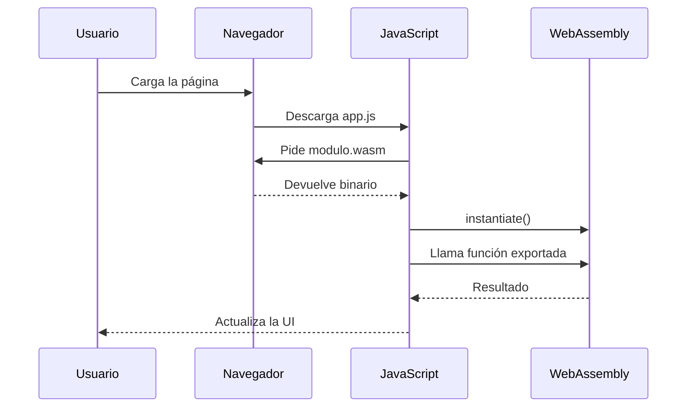

## 13. Arquitectura WebXR

[Ver en el capítulo original](capitulos/29-webxr.md)

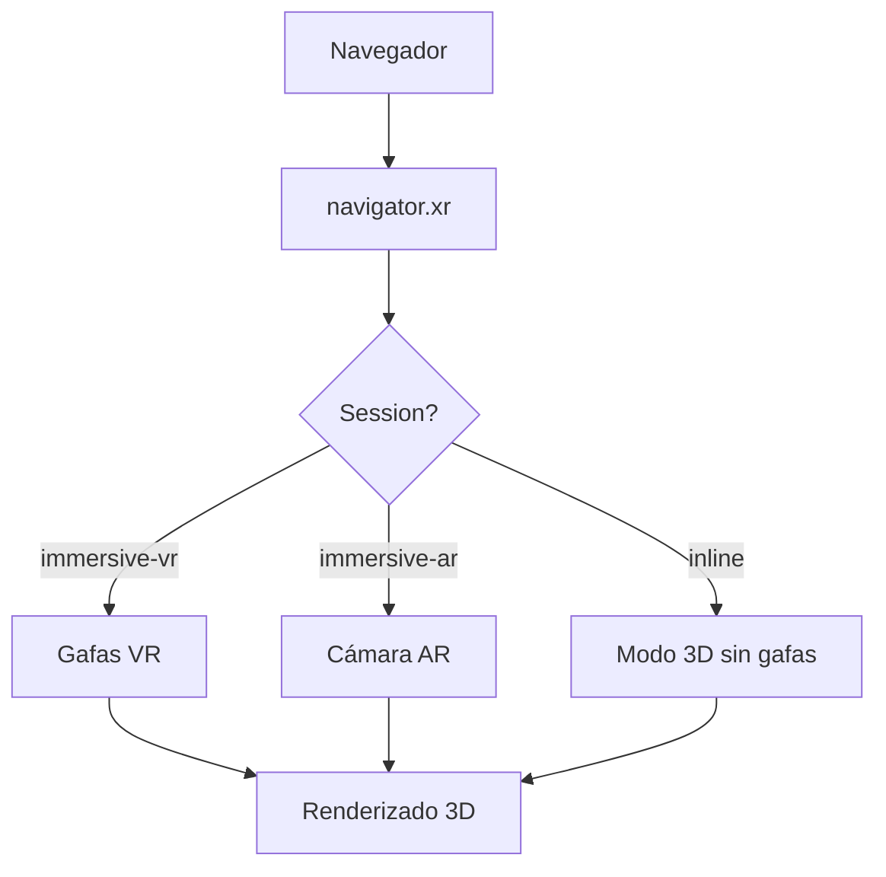

## 14. Cómo interactúa una dApp

[Ver en el capítulo original](capitulos/30-web3.md)

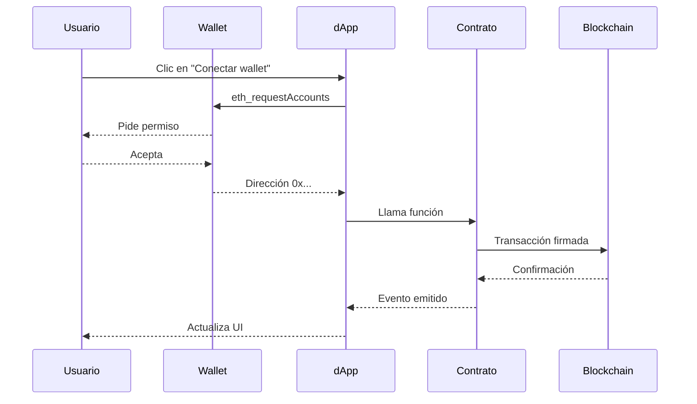

---

## 🛠️ Cómo se hacen estos diagramas

Todos están escritos en **Mermaid**, un lenguaje que permite describir diagramas con texto plano. MkDocs Material los renderiza automáticamente al construir el sitio.

**Ventajas:**

- **Versionables** en Git como texto.
- **Editables** por cualquiera.
- **Sin imágenes** que actualizar.
- **Se adaptan** al modo claro y oscuro del sitio.

Más información: [mermaid.js.org](https://mermaid.js.org/)
