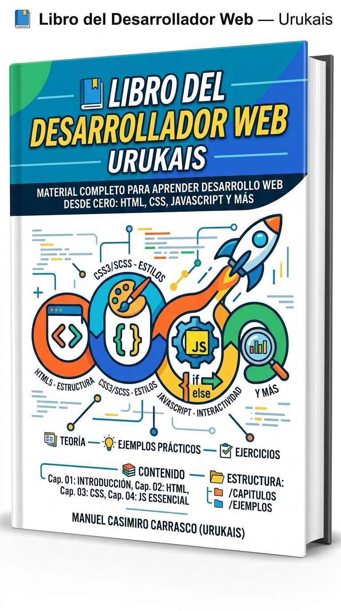
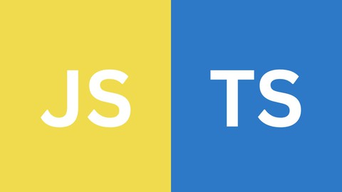
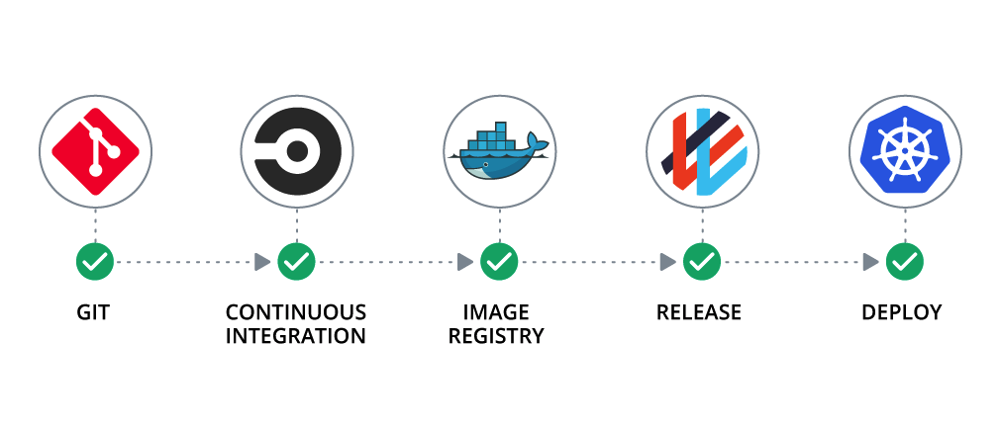
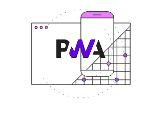
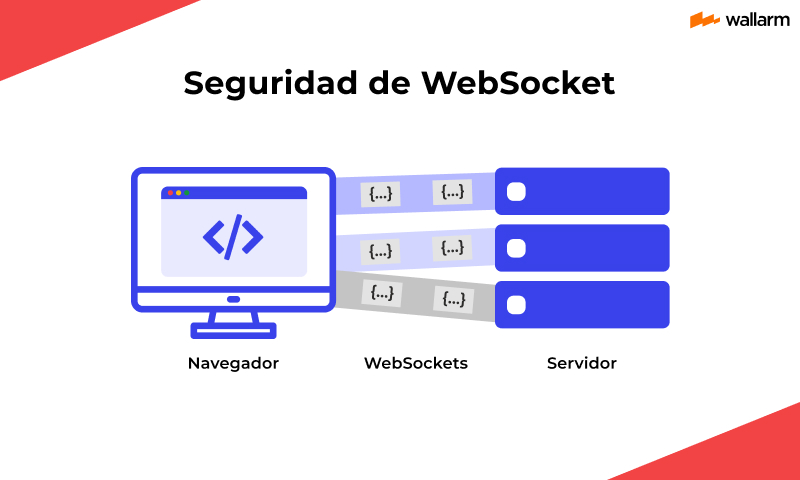
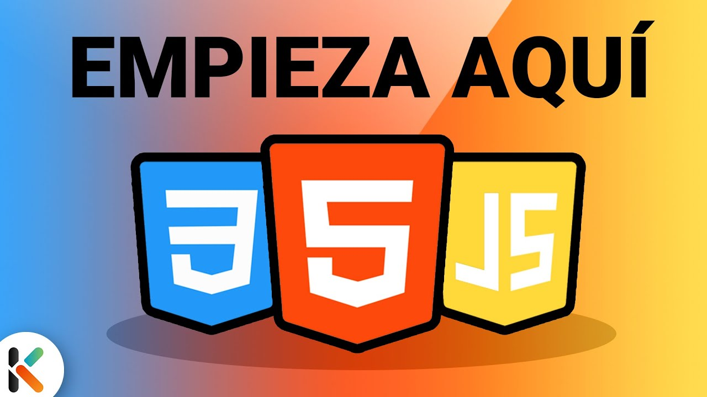

# Web Developer Book

**The definitive handbook to learn web development.** From the fundamentals to the cutting edge of technology.

[🚀 Start Level 1](capitulos/01-introduccion.md){ .md-button .md-button--primary }
[📖 View syllabus](introduccion.md){ .md-button }
[🏆 My achievements](logros.md){ .md-button }

  

    38
    Chapters
  

  

    7
    Levels
  

  

    30
    Exercises
  

  

    14
    Diagrams
  

-   [:material-book-open-variant:{ .lg .middle } **38 chapters**](#the-developers-journey)

    ---

    Organized into 7 progressive levels, from beginner to cutting edge.

-   [:material-code-braces:{ .lg .middle } **100% interactive**](playground.md)

    ---

    Quizzes, live editors, validated challenges, and an achievement system.

-   [:material-certificate:{ .lg .middle } **Certification**](certificado.md)

    ---

    Generate your PDF certificate upon completing the book.

-   [:material-github:{ .lg .middle } **Open Source**](https://github.com/urukaisk-maker/Libro-desarrollador-Web-Urukais-){ target=_blank rel=noopener }

    ---

    No ads, no subscriptions, no paywalls. MIT License.

---

## 🚀 The Developer's Journey

-   

    **Level 1: Beginner**

    HTML, CSS, JavaScript, responsive design, and forms.

    [:octicons-arrow-right-24: Start the journey](capitulos/01-introduccion.md)

-   

    **Level 2: Intermediate**

    Git, APIs, deployment, and portfolio.

    [:octicons-arrow-right-24: Level up](capitulos/07-git.md)

-   

    **Level 3: Advanced**

    Modern CSS, async JS, TypeScript, and testing.

    [:octicons-arrow-right-24: Explore the craft](capitulos/11-css-moderno.md)

-   

    **Level 4: Professional**

    Full-stack with Node.js and DevOps.

    [:octicons-arrow-right-24: Think like a pro](capitulos/19-fullstack-node.md)

-   

    **Level 5: Expert**

    Web Components, PWA, WebSockets, and design systems.

    [:octicons-arrow-right-24: Build experiences](capitulos/21-web-components.md)

-   

    **Level 6: Elite**

    Security, WebAssembly, AI, WebXR, and Web3.

    [:octicons-arrow-right-24: Break boundaries](capitulos/26-seguridad.md)

-   

    **Level 7: Cutting Edge**

    E2E testing, Server Components, Edge, Docker, and GraphQL.

    [:octicons-arrow-right-24: Go to the future](capitulos/31-testing-e2e.md)

---

## 🛠 Tools and Resources

- **[Runnable examples](ejemplos/index.md)** — Ready-to-test code.
- **[Diagram gallery](diagramas.md)** — Architecture and flows.
- **[Solved exercises](ejercicios/index.md)** — Annotated solutions.
- **[Schedule](agenda.md)** · **[Journal](diario.md)** · **[Challenges](retos.md)** · **[Reader projects](proyectos-lectores.md)** · **[Community challenges](retos-comunidad.md)**
- **[Interview questions](entrevistas.md)** · **[Support the project](apoya.md)** · **[Hall of Fame](hall-of-fame.md)**

---

## 📰 Latest from the Journal

- **[The day the book came to life](diario.md)** — Oct 18, 2026
- **[When I decided to add quizzes](diario.md)** — Oct 15, 2026
- **[The playground problem](diario.md)** — Oct 10, 2026

---

## 🛠 The Stack You Will Master

🌐 HTML · 🎨 CSS · ⚡ JavaScript · 🔷 TypeScript · ⚛ React · 🟢 Node.js · 🔀 Git · 🐳 Docker

---

## 💡 Why This Book?

-   

    **100% Interactive**

    Quizzes, live editors, challenges with automated validation, and an achievement system.

-   

    **Progressive and Structured**

    7 levels designed so you never lose your way.

-   

    **Open Source and Free**

    No ads, no subscriptions, no paywalls. Everything on GitHub under the MIT License.

---

## 📄 Take the Book With You

[Download printable version (PDF)](print_page/){ .md-button }

---

## Is the book helping you?

[⭐ Star it on GitHub](https://github.com/urukaisk-maker/Libro-desarrollador-Web-Urukais-){ .md-button .md-button--primary target=_blank rel=noopener }
[📬 Subscribe to the newsletter](https://urukaisklick.substack.com/){ .md-button target=_blank rel=noopener }

---

## 📌 The Project

[Philosophy](filosofia.md) · [Roadmap](roadmap.md) · [Changelog](changelog.md) · [Contribute](contribuir.md) · [FAQ](faq.md) · [Contact](contacto.md)

---

## 👤 About the Author

This book is a project by **Manuel Casimiro Carrasco (Urukais)**. [More info](autor.md).

---

## 📜 License

[MIT License](licencia.md) — You may use, copy, modify, and distribute the content freely.
