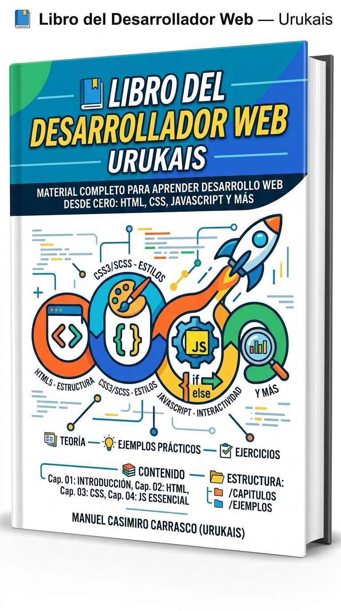
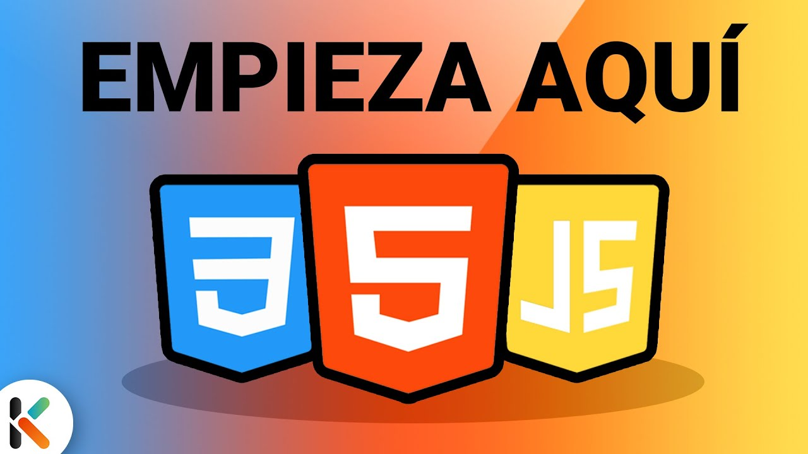
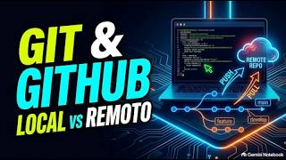
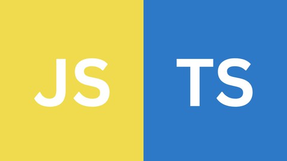
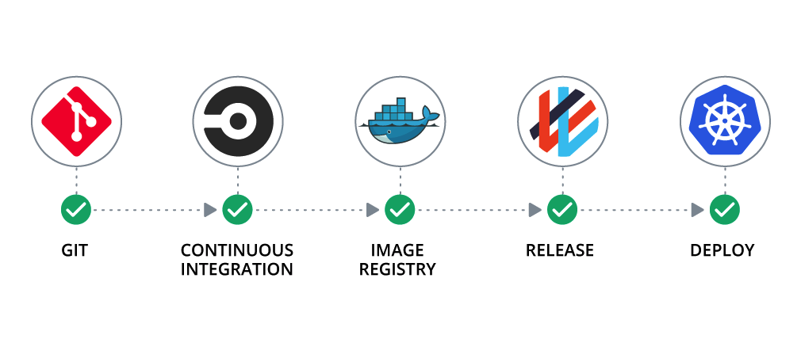
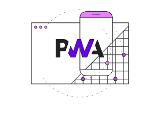
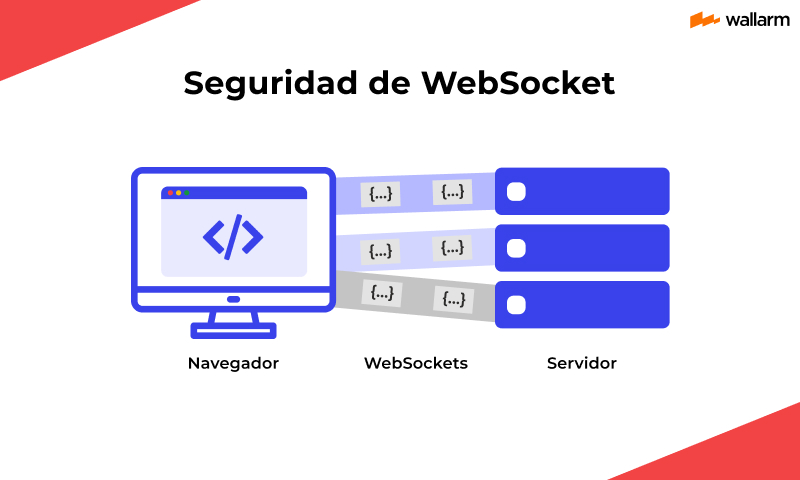

# Libro del Desarrollador Web

**El manual definitivo para aprender desarrollo web en español.**
Desde los cimientos hasta la vanguardia tecnológica.

[🚀 Empezar el Nivel 1](capitulos/01-introduccion.md){ .md-button .md-button--primary }
[📖 Ver el temario](introduccion.md){ .md-button }
[🏆 Mis logros](logros.md){ .md-button }

-   [:material-book-open-variant:{ .lg .middle } **38 capítulos**](#el-viaje-del-desarrollador)

    ---

    Organizados en 7 niveles progresivos, de principiante a vanguardia.

-   [:material-code-braces:{ .lg .middle } **100% interactivo**](playground.md)

    ---

    Quizzes, editores en vivo, retos validados y sistema de logros.

-   [:material-certificate:{ .lg .middle } **Certificación**](certificado.md)

    ---

    Genera tu certificado en PDF al completar el libro.

-   [:material-github:{ .lg .middle } **Open Source**](https://github.com/urukaisk-maker/Libro-desarrollador-Web-Urukais-){ target=_blank }

    ---

    Sin anuncios, sin suscripciones, sin muros de pago. MIT.

---

## 🚀 El Viaje del Desarrollador

-   

    **Nivel 1: Principiante**

    HTML, CSS, JavaScript, responsive y formularios.

    [:octicons-arrow-right-24: Empezar el viaje](capitulos/01-introduccion.md)

-   

    **Nivel 2: Intermedio**

    Git, APIs, despliegue y portfolio.

    [:octicons-arrow-right-24: Subir de nivel](capitulos/07-git.md)

-   

    **Nivel 3: Avanzado**

    CSS moderno, JS asíncrono, TypeScript, testing.

    [:octicons-arrow-right-24: Explorar la técnica](capitulos/11-css-moderno.md)

-   

    **Nivel 4: Profesional**

    Full-stack con Node.js y DevOps.

    [:octicons-arrow-right-24: Pensar como pro](capitulos/19-fullstack-node.md)

-   

    **Nivel 5: Experto**

    Web Components, PWA, WebSockets, design systems.

    [:octicons-arrow-right-24: Crear experiencias](capitulos/21-web-components.md)

-   

    **Nivel 6: Élite**

    Seguridad, WebAssembly, IA, WebXR, Web3.

    [:octicons-arrow-right-24: Romper límites](capitulos/26-seguridad.md)

-   

    **Nivel 7: Vanguardia**

    Testing E2E, Server Components, Edge, Docker, GraphQL.

    [:octicons-arrow-right-24: Ir al futuro](capitulos/31-testing-e2e.md)

---

## 🛠 Herramientas y Recursos

- **[Ejemplos ejecutables](ejemplos/index.md)** — Código listo para probar.
- **[Galería de diagramas](diagramas.md)** — Arquitectura y flujos.
- **[Ejercicios resueltos](ejercicios/index.md)** — Soluciones comentadas.
- **[Agenda](agenda.md)** · **[Diario](diario.md)** · **[Retos](retos.md)** · **[Proyectos](proyectos-lectores.md)** · **[Retos de la comunidad](retos-comunidad.md)**
- **[Preguntas de entrevista](entrevistas.md)** · **[Apoya el proyecto](apoya.md)** · **[Hall of Fame](hall-of-fame.md)**

---

## 📰 Últimas del Diario

- **[El día que el libro cobró vida](diario.md)** — 18 oct 2026
- **[Cuando decidí añadir quizzes](diario.md)** — 15 oct 2026
- **[El problema de los playgrounds](diario.md)** — 10 oct 2026

---

## 🛠 El Stack que dominarás

🌐 HTML · 🎨 CSS · ⚡ JavaScript · 🔷 TypeScript · ⚛ React · 🟢 Node.js · 🔀 Git · 🐳 Docker

---

## 💡 ¿Por qué este libro?

-   

    **100% Interactivo**

    Quizzes, editores en vivo, retos con validación automática y sistema de logros.

-   

    **Progresivo y Estructurado**

    7 niveles diseñados para que no te pierdas en el camino.

-   

    **Open Source y Gratuito**

    Sin anuncios, sin suscripciones, sin muros de pago. Todo en GitHub bajo licencia MIT.

---

## 📄 Llévate el libro contigo

[Descargar versión imprimible (PDF)](print_page/){ .md-button }

---

## 📌 El Proyecto

[Filosofía](filosofia.md) · [Roadmap](roadmap.md) · [Changelog](changelog.md) · [Contribuir](contribuir.md) · [FAQ](faq.md) · [Contacto](contacto.md)

---

## 👤 Sobre el Autor

Este libro es un proyecto de **Manuel Casimiro Carrasco (Urukais)**. [Más información](autor.md).

---

## 📜 Licencia

[Licencia MIT](licencia.md) — Puedes usar, copiar, modificar y distribuir el contenido libremente.