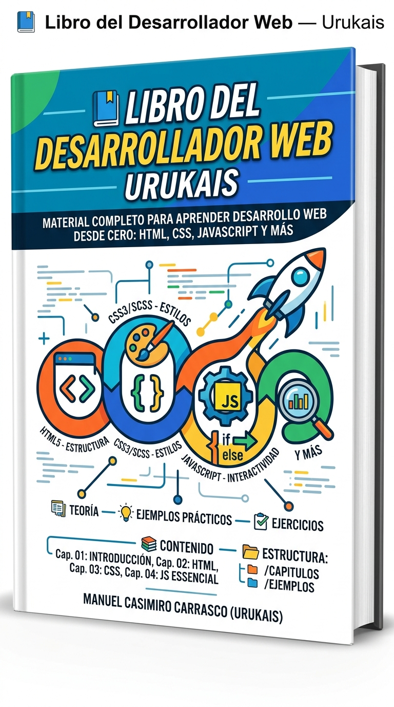

  

  

    36
    Capítulos
  

  

    7
    Niveles
  

  

    14
    Diagramas
  

  

    100%
    Open Source
  

  <a href="capitulos/01-introduccion/" class="book-hero__cta">Empezar a leer →</a>

## 🚀 El Viaje del Desarrollador

Este libro no es solo un tutorial. Es un **camino estructurado** que te lleva desde tus primeros pasos en HTML hasta las arquitecturas más avanzadas que se usan hoy en Silicon Valley.

-   :material-numeric-1-circle:{ .lg .middle } __Nivel 1: Principiante__

    ---

    Aprende las bases: HTML, CSS, JavaScript, diseño responsive y formularios.

    [:octicons-arrow-right-24: Empezar el viaje](capitulos/01-introduccion.md)

-   :material-numeric-2-circle:{ .lg .middle } __Nivel 2: Intermedio__

    ---

    Domina Git, el consumo de APIs, despliegue en producción y tu primer portfolio.

    [:octicons-arrow-right-24: Subir de nivel](capitulos/07-git.md)

-   :material-numeric-3-circle:{ .lg .middle } __Nivel 3: Avanzado__

    ---

    CSS moderno, JavaScript asíncrono, TypeScript, testing y arquitectura frontend.

    [:octicons-arrow-right-24: Explorar la técnica](capitulos/11-css-moderno.md)

-   :material-numeric-4-circle:{ .lg .middle } __Nivel 4: Profesional__

    ---

    Conviértete en Full-stack con Node.js y domina el DevOps para frontend.

    [:octicons-arrow-right-24: Pensar como pro](capitulos/19-fullstack-node.md)

-   :material-numeric-5-circle:{ .lg .middle } __Nivel 5: Experto__

    ---

    Web Components, PWA, WebSockets, animaciones avanzadas y design systems.

    [:octicons-arrow-right-24: Crear experiencias](capitulos/21-web-components.md)

-   :material-numeric-6-circle:{ .lg .middle } __Nivel 6: Élite__

    ---

    Seguridad, WebAssembly, IA en el frontend, WebXR y Web3.

    [:octicons-arrow-right-24: Romper límites](capitulos/26-seguridad.md)

-   :material-rocket-launch:{ .lg .middle } __Nivel 7: Vanguardia__

    ---

    Testing E2E, Server Components, Edge Computing, Docker, GraphQL y Micro-frontends.

    [:octicons-arrow-right-24: Ir al futuro](capitulos/31-testing-e2e.md)

