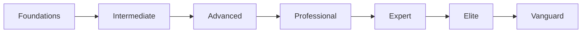

# 👋 Welcome to the Web Developer Book

!!! quote "From zero to Silicon Valley"
    This book starts with a simple idea: **anyone can learn to code** with a clear guide, real examples, and a willingness to practice. You do not need a degree, an expensive machine, or a paid course. Just a browser, a text editor, and consistency.

We will walk with you from your very first HTML tag to the most advanced architectures in modern development: TypeScript, Web Components, PWA, Edge Computing, Generative AI, and more.

---

## 🎯 Who is this book for?

This material is designed for **three clear profiles**:

| Profile | What you will find here |
| :--- | :--- |
| 🌱 **Absolute beginner** | Explanations from scratch, assuming no prior background. Every concept is introduced with runnable examples. |
| 🎓 **Student or self-learner** | Structured reference material across 7 levels, with solved exercises and weekly challenges. |
| 🔄 **Career switcher / professional** | Advanced chapters on architecture, testing, performance, and production deployment. |

!!! tip "Not sure where to start?"
    If it is your first time coding, head straight to the [Beginner Level](capitulos/01-introduccion.md). If you already have experience, jump to the level that matches your current skills using the **🗂 Explore** button in the top menu.

---

## 📚 What will you learn?

The book is split into **7 progressive levels** and **38 chapters**, designed so you can move forward without getting lost:

=== "🟢 Foundations"

    - Semantic and accessible **HTML5**
    - Modern **CSS3**: Flexbox, Grid, custom properties, animations
    - Core **JavaScript**: variables, functions, DOM, events
    - **Responsive design** with media queries and mobile-first
    - HTML **forms** and native validation

=== "🟡 Intermediate"

    - **Git and GitHub**: version control and team workflows
    - **REST APIs** with `fetch` and `async/await`
    - **Deployment** on Netlify, Vercel, GitHub Pages
    - **Your first portfolio**

=== "🟠 Advanced"

    - **Modern CSS**: container queries, `:has()`, subgrid
    - Deep-dive **asynchronous JavaScript**: promises, event loop
    - ES6 **modules** and bundlers (Vite, esbuild)
    - **TypeScript** from scratch
    - **Testing** with Vitest and Testing Library
    - **Accessibility** (WCAG and ARIA)

=== "🔴 Professional"

    - **Full-stack with Node.js**: Express, databases, authentication
    - **Frontend DevOps**: CI/CD, Docker, monitoring

=== "🟣 Expert"

    - Native **Web Components**
    - **PWA** with service workers
    - **WebSockets** and real time
    - Advanced **animations** with GSAP and Framer Motion
    - Scalable **design systems**

=== "🔵 Elite"

    - **Web security**: XSS, CSRF, CSP, CORS
    - **WebAssembly** in the browser
    - **Frontend AI** with TensorFlow.js
    - **WebXR** for augmented and virtual reality
    - **Web3** and blockchain

=== "🚀 Vanguard"

    - **E2E testing** with Playwright
    - **React Server Components**
    - **Edge Computing** with Cloudflare Workers
    - **Docker** for frontend
    - **GraphQL** and **micro-frontends**
    - **Generative AI** applied to development

---

## 🛠 What do you need to get started?

Just three things, all free:

1. **A modern browser** (up-to-date Chrome, Firefox, Edge, or Safari)
2. **A code editor**: we recommend [VS Code](https://code.visualstudio.com/) or [Zed](https://zed.dev/)
3. **Lots of drive to practice** 💪

!!! note "Nothing to install to start"
    The first chapters can be followed directly in the browser using the **live editors** on each page. Only when you reach Node.js will you need to install tools on your machine.

---

## 📖 How to read this book

### Recommended order

Follow the chapters **in order** if you are just starting out. Each one builds on the previous one:

