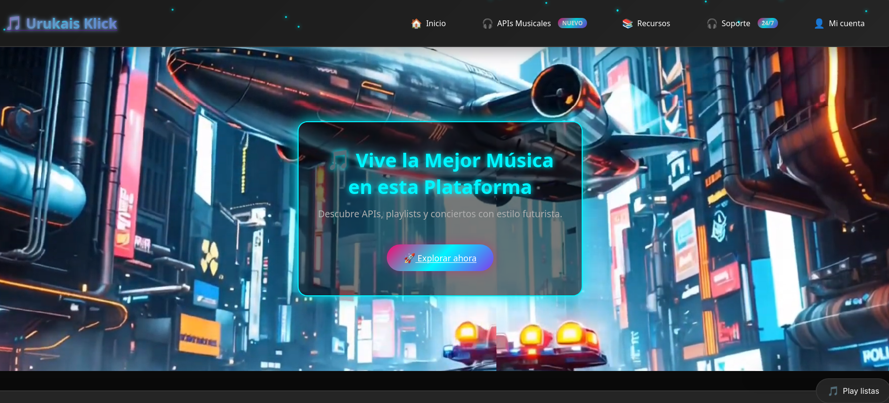
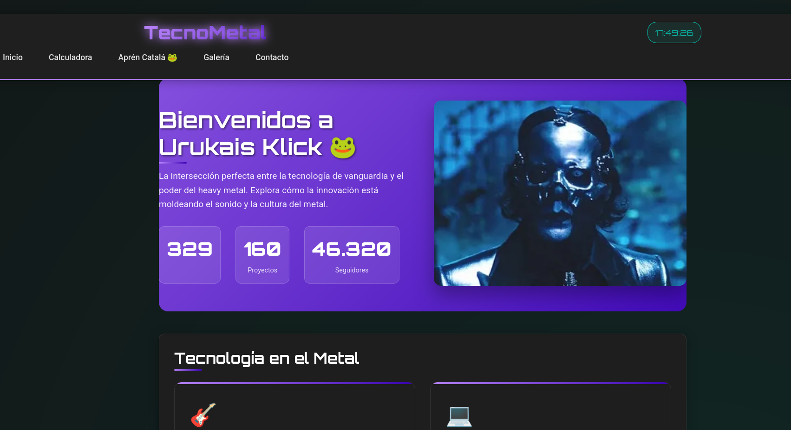
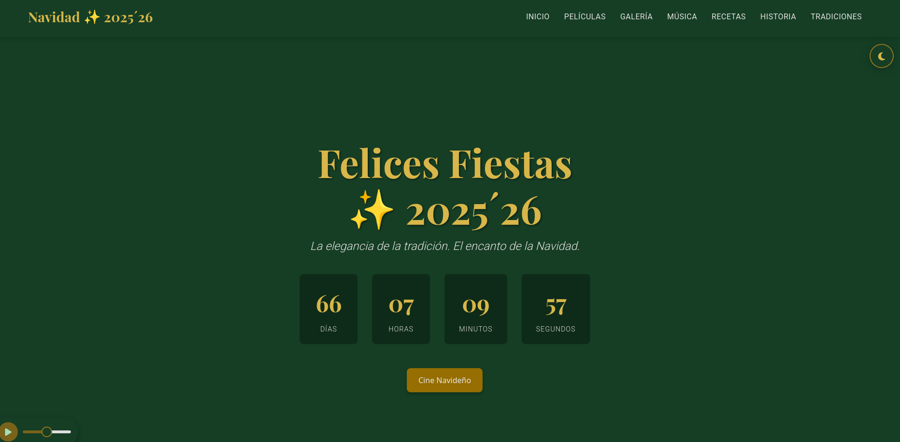
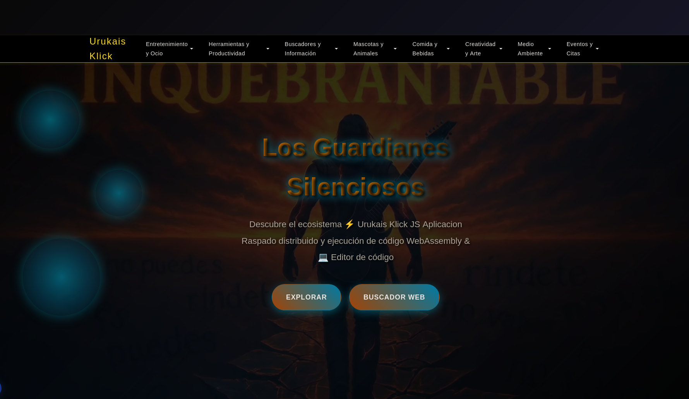
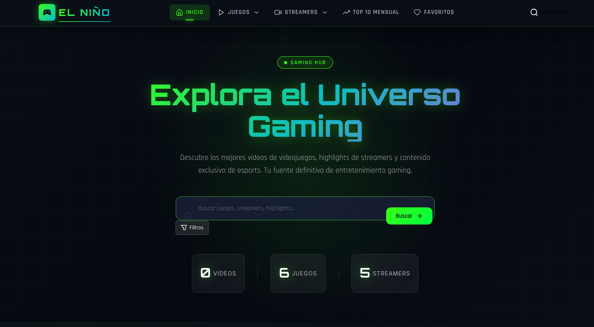
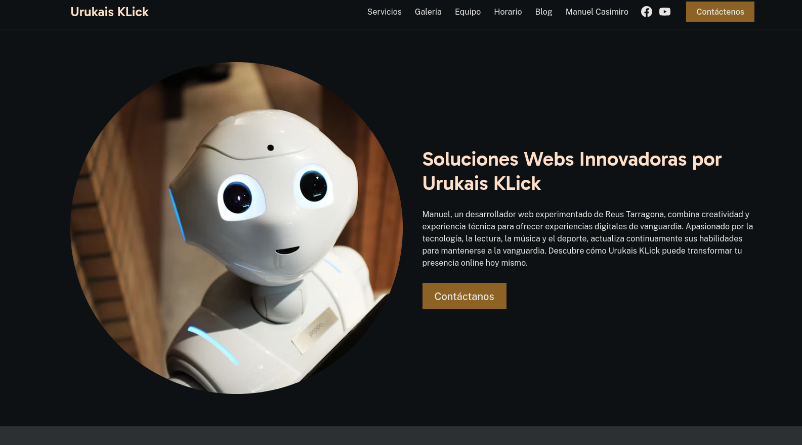

# 🚀 Mis Proyectos

Una colección de las aplicaciones web, experimentos y herramientas que he construido. Todos ellos están desarrollados con las tecnologías y prácticas que enseño en este libro.

-   :material-music-note-eighth:{ .lg .middle } __🎵 Vive la Mejor Música__

    ---

    { style="width: 100%; border-radius: 8px; margin-bottom: 1rem;" }

    **Plataforma:** Descubre APIs, playlists y conciertos con estilo futurista.
    
    *Explora más de 150 APIs dedicadas al mundo de la música: streaming, análisis de audio, conciertos, radio, podcasts…*

    [:octicons-arrow-right-24: Explorar ahora](https://thriving-otter-cc1e25.netlify.app/){ target="_blank" }

-   :material-guitar-electric:{ .lg .middle } __🐸 Bienvenidos a Urukais Klick__

    ---

    { style="width: 100%; border-radius: 8px; margin-bottom: 1rem;" }

    **Heavy Metal & Tech:** La intersección perfecta entre la tecnología de vanguardia y el poder del heavy metal.
    
    📊 **329** Proyectos · 👥 **46.320** Visitas

    [:octicons-arrow-right-24: Visitar sitio](https://unique-biscochitos-31bcea.netlify.app/){ target="_blank" }

-   :material-snowflake:{ .lg .middle } __✨ Felices Fiestas 2025'26__

    ---

    { style="width: 100%; border-radius: 8px; margin-bottom: 1rem;" }

    **Navidad:** La elegancia de la tradición. El encanto de la Navidad. Clásicos y joyas modernas del cine navideño.
    
    🎄 **67 Días** · ⏰ **04 Horas** · ⏳ **29 Min**

    [:octicons-arrow-right-24: Ver portal navideño](https://tranquil-taffy-3dbe57.netlify.app/){ target="_blank" }

-   :material-shield-lock:{ .lg .middle } __⚡ Los Guardianes Silenciosos__

    ---

    { style="width: 100%; border-radius: 8px; margin-bottom: 1rem;" }

    **Seguridad y JS:** Descubre el ecosistema de raspado distribuido y ejecución de código WebAssembly. Un editor de código seguro para explorar el poder de la navegación sagrada.

    [:octicons-arrow-right-24: Explorar ecosistema](https://rad-dolphin-182dfb.netlify.app/){ target="_blank" }

-   :material-gamepad-variant:{ .lg .middle } __🎮 Urukais-Klick Gaming__

    ---

    { style="width: 100%; border-radius: 8px; margin-bottom: 1rem;" }

    **Gaming:** Tu plataforma definitiva de contenido gaming. Descubre los mejores videos de videojuegos, highlights de streamers y tendencias (Valorant, LoL, Twitch, YouTube).

    [:octicons-arrow-right-24: Entrar al gaming](https://cheery-frangollo-67ca1e.netlify.app/user_input_files/index.html){ target="_blank" }

-   :material-robot:{ .lg .middle } __🤖 Soloist AI__

    ---

    { style="width: 100%; border-radius: 8px; margin-bottom: 1rem;" }

    **Inteligencia Artificial:** Mi perfil profesional y experimentos con herramientas de Inteligencia Artificial. Innovación y vanguardia.

    [:octicons-arrow-right-24: Visitar perfil](https://soloist.ai/urukaisklick){ target="_blank" }

---

!!! tip "Hecho con el libro"
    Todos estos proyectos son míos y los he construido aplicando las técnicas que verás en los 38 capítulos del libro. ¡Pruébalos y dime qué te parecen!