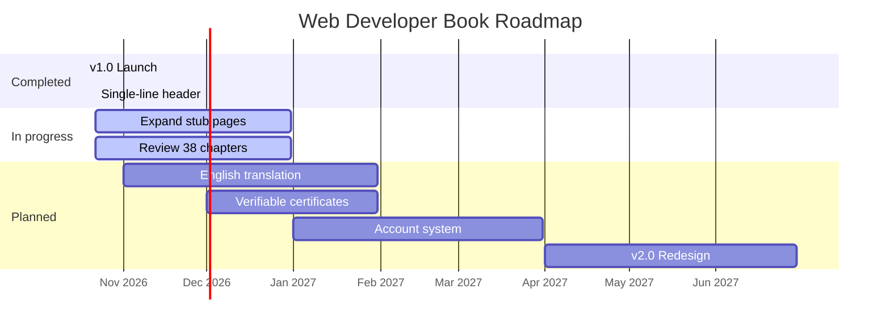

# 🗺 Project Roadmap

!!! quote "Where this project is heading"
    This is the future plan for the **Web Developer Book**. It is not a contractual promise: it is an **open roadmap** that may shift depending on priorities, available time, and community suggestions.

---

## 🎯 Roadmap philosophy

Before looking at the lists, it helps to understand **how items are prioritized** in this project:

| Priority | Criteria |
| :--- | :--- |
| 🔴 **High** | Missing content, bugs that impact learning, accessibility |
| 🟠 **Medium** | UX improvements, new features, translations |
| 🟡 **Low** | Extras, experiments, long-term ideas |

!!! warning "No committed release dates"
    The project is maintained in the author's free time. **There are no release dates**. Versions ship when they are ready, not on a fixed schedule. If something shows "Q1 2027", treat it as an estimate, not an obligation.

---

## ✅ Completed

Everything already available in the book:

### Content
- [x] **38 chapters** organized across 7 levels
- [x] **30 solved exercises** with annotated solutions
- [x] **14 Mermaid diagrams** covering architecture and flows
- [x] **5 weekly challenges** with automated validation
- [x] **Glossary** with ~90 terms
- [x] **Cheat sheets** for HTML, CSS, JS, and Git
- [x] **Resources by level** with recommendations

### Features
- [x] **Achievement system** with `localStorage`
- [x] **Interactive quizzes** at the end of each chapter
- [x] **Live code editors** with sandboxed iframes
- [x] **StackBlitz labs** for Node.js
- [x] **Giscus comments** anchored to GitHub Discussions
- [x] **Dark and light mode** with persistence
- [x] **Installable PWA** with offline support
- [x] **Printable version** in PDF
- [x] **Search** with suggestions and highlighting
- [x] **Ctrl+K shortcut** for quick search
- [x] **Reading progress** with a top bar
- [x] **Newsletter** with subscription modal
- [x] **GDPR-compliant cookie banner**

### Design
- [x] **"Explore" mega-menu** in the header (desktop)
- [x] **Single-line header** (logo + title + menu + search + repo)
- [x] **5-column premium footer**
- [x] **Responsive design** (mobile, tablet, desktop)
- [x] **Unified color palette** (purple + cyan)
- [x] **Premium typography** (Inter + JetBrains Mono)
- [x] **Subtle hover animations**

### Infrastructure
- [x] **MkDocs + Material for MkDocs**
- [x] **GitHub Actions** for automated deployment
- [x] **GitHub Pages** hosting
- [x] **Custom domain**: `libro.urukais.com`
- [x] **Google Analytics 4** for analytics
- [x] **Google Search Console** for SEO

---

## 🚧 In progress

What is currently under active development:

### Content
- [ ] **Expanding stub pages**: `logros.md`, `agenda.md`, `entrevistas.md`, `musica.md`, `proyectos-guiados.md`, `hall-of-fame.md`, `certificado.md`, `apoya.md`, `recursos.md`
- [ ] **Reviewing all 38 chapters** to fix typos and refresh examples
- [ ] **More solved exercises** (target: 50)

### Features
- [ ] **Semantic search** with embeddings (experimental)
- [ ] **Nested comments** in Giscus (currently flat)
- [ ] **"Read-only" mode** for distraction-free printing

---

## 📅 Planned

What is on the medium-term roadmap:

### Q4 2026 (October–December)

- [ ] **English translation** with `mkdocs-static-i18n`
  - Priority: 🔴 High
  - Impact: reach a wider audience
  - Estimate: 2–3 months
- [ ] **Verifiable certificates** with QR code
  - Priority: 🟠 Medium
  - Impact: provide tangible value upon completing the book
  - Estimate: 1 month
- [ ] **Account system** to sync achievements across devices
  - Priority: 🟠 Medium
  - Impact: avoid losing progress when switching browsers
  - Estimate: 2 months

### Q1 2027 (January–March)

- [ ] **More interactive labs** with StackBlitz and CodeSandbox
  - Priority: 🟠 Medium
  - Impact: improve hands-on practice for backend and DevOps
  - Estimate: —
- [ ] **Daily streak** Duolingo-style
  - Priority: 🟡 Low
  - Impact: encourage consistency
  - Estimate: —
- [ ] **Hall of Fame** featuring profiles of readers who complete the book
  - Priority: 🟡 Low
  - Impact: build community
  - Estimate: —

### Q2 2027 (April–June)

- [ ] **Full site redesign** (version 2.0)
  - Priority: 🟡 Low
  - Impact: improve overall experience
  - Estimate: —
- [ ] **Guest chapters** by other community authors
  - Priority: 🟡 Low
  - Impact: diversify perspectives
  - Estimate: —
- [ ] **Embedded explainer videos** in selected chapters
  - Priority: 🟡 Low
  - Impact: reach learners who prefer watching
  - Estimate: —

---

## 💡 Long-term ideas

Things I would like to build, without a set date or priority yet:

- [ ] **Full offline mode** with an advanced Service Worker
- [ ] **Native mobile app** (PWA already covers part of this)
- [ ] **One-on-one mentoring** system
- [ ] **Discord community** with channels by level
- [ ] **Verifiable certificates** on blockchain (yes, seriously)
- [ ] **GitHub Classroom integration** for educators
- [ ] **Translations into other languages**: Portuguese, French, Italian
- [ ] **Custom cover PDF generation**
- [ ] **"Teacher" mode** with auto-graded exercises
- [ ] **Public API** to query the book's content

!!! tip "Have an idea?"
    If you think something important is missing, open an [issue on GitHub](https://github.com/urukaisk-maker/Libro-desarrollador-Web-Urukais-/issues/new) with the `enhancement` label. Community ideas are reviewed every week.

---

## 📊 Visual timeline

